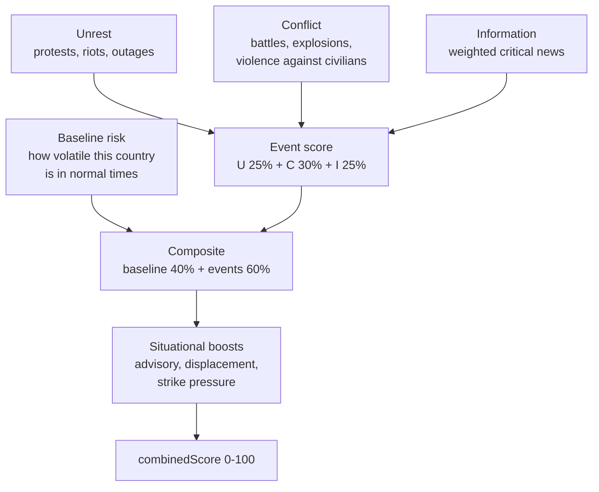

_Methodology maintained by [Elie Habib](https://www.worldmonitor.app/blog/authors/elie-habib/), founder of World Monitor. Published revisions are recorded in the [corrections log](/corrections)._

## Start here

The Country Instability Index answers one operational question:
**which country should I look at first today?**

It is a 0-100 stress reading, recomputed continuously for a curated watchlist of
countries. It rises when protests, fighting, strikes on the country, and news
pressure pick up at the same time in the same place.

A high CII does not mean "dangerous country." It means **a lot is happening
here right now**. A stable country having a genuinely bad week will out-score a
chronically troubled country having a quiet one, and that is the intended
behavior — CII is a triage dial, not a verdict.

### The four things it watches

| Component | What it picks up |
|---|---|
| **Unrest** | Protests, riots, and the outages that follow them — friction before violence. |
| **Conflict** | Actual fighting: battles, explosions, violence against civilians. |
| **Security** | Nothing since v15: its four inputs (foreign military flights and vessels, aviation delays, GPS jamming) did not measure instability inside the country, so the component reads 0 with weight 0 until it is rebuilt. |
| **Information** | How hard the news environment is running on this country. |

### How the number is assembled

Every country carries a **baseline** — how volatile it is in normal times — and
an **event multiplier** that scales how much a given incident should move the
needle there. The headline score is 40% baseline and 60% live events, then
adjusted by situational boosts for things like strikes, displacement, and
travel advisories. Since v15 the live events can reach 80 of their 100 points,
because Security carries no weight.

That 40/60 split is the whole design. It is why a fragile country never reads as
calm, and why a genuine crisis in a stable one still moves the number fast.



### What it is and is not

**It is** a single number to help an operator triage where to look first on a
fast-moving dashboard.

**It is not** a forecast, an insurance pricing input, or a substitute for
travel-advisory guidance from a sovereign government. It is also **not** the
[Country Resilience Index](/methodology/country-resilience-index), which asks
the opposite question: not *what is happening to this country*, but *how well
could it take a hit*. The dashboard shows them together because a country can
be calm and fragile, or under heavy pressure and structurally tough.

Where WorldMonitor does forecast, that record is published. The
[forecast accuracy scorecard](https://www.worldmonitor.app/accuracy/) publishes
the forecast track record and its methodology.

<Warning>
**These weights are editorial, not empirical.** They were authored by the
WorldMonitor intelligence team from internal review of historical incidents and
current geopolitical posture. They are **not** derived from a published academic
index, a peer-reviewed paper, or a third-party risk product. Reasonable analysts
will disagree with individual entries.

The entire point of publishing this page is to make those opinions inspectable,
so you can decide whether you agree before you rely on them. If a consequential
decision depends on these scores, pin against the `methodology_version` field on
each `CiiScore`, watch for version bumps, and weigh the per-country
`event_multiplier` against your own ground truth.
</Warning>

The countries covered are a **curated monitoring universe**, not every sovereign
state — see [the Tier-1 criteria](#2-per-country-baselinerisk-and-eventmultiplier).
CRI covers the broader 196-country universe.

<Note>
**For developers.** CII and the Strategic Risk roll-up are served from
`GET /api/intelligence/v1/get-risk-scores` (proto
`worldmonitor.intelligence.v1.GetRiskScoresResponse`). The on-the-wire
`methodology_version` field on every `CiiScore` records which revision of this
document was active when the score was computed. The current version is **v14** —
see [Version history](#version-history).
</Note>

---

## 1. The four CII components

Each Tier-1 country gets four sub-scores in the `0–100` range. These are
exposed on the wire as `CiiComponents`:

| Wire field | Editorial meaning |
|---|---|
| `cii_contribution` (**U**nrest) | Civil disorder pressure: ACLED protests + riots, fatalities from those events, confirmed internet/power outages, and a high-severity unrest boost. While ACLED returns no events, a GDELT protest term (escalation or sustained level, below) stands in for the ACLED event terms. Reflects pre-violent friction. |
| `geo_convergence` (**C**onflict) | Kinetic activity: ACLED battles, explosions/remote violence, and violence-against-civilians events, plus Israel OREF alert pressure. Strikes on the country count through strike pressure (below), on the composite, not in this component. Event activity is log-scaled before the component cap so moderate and extreme event volumes remain ordered; square-root fatality scaling prevents single-event saturation. While ACLED returns no events, a GDELT conflict term (escalation or sustained level, below) stands in for the ACLED event terms. |
| `military_activity` (**S**ecurity) | Always 0 since v15, with weight 0. Its inputs left the score: foreign military flights (NATO transports at cruise altitude), foreign military vessels (88% were AIS types 35 and 50–59: pilot boats, SAR, tugs), aviation delays (a count of reporting airports) and GPS jamming (scored where the effect lands, not the jammer). The country's own air force and navy stopped scoring in v14. The field stays on the wire. |
| `news_activity` (**I**nformation) | Information-environment pressure: weighted count of classified critical/high/medium news headlines geo-attributed to the country. |

The four components are weighted into the headline `combinedScore`:

```
eventScore = U * 0.25 + C * 0.30 + S * 0 + I * 0.25   (S = 0; its 0.20 is not redistributed)

composite = baseline * 0.4
          + eventScore * 0.6
          + advisoryBoost     (≤ 15)
          + orefBlendBoost    (IL only, ≤ 25)
          + displacementBoost (≤ 20)
          + crossBorderArrivalSurgeBoost (0 or 5)
          + newsUrgencyBoost  (≤  5)
          + strikeBoost       (≤ 10, strike pressure)
```

Component details that are easy to miss:

- **Unrest severity boost**: high-severity ACLED unrest events (for example,
  riots) add `min(20, highSeverityUnrest * 10 * eventMultiplier)` inside the
  Unrest component.
- **Conflict civilian boost**: violence-against-civilians events add
  `min(10, civilianViolence * 3)` after the log-scaled conflict activity and
  fatality terms.
- **Strike pressure (v12)**: a country being struck rises, keeps rising while
  the strikes continue, and drifts back once they stop. Each country gets a
  daily strike intensity `x_d`, the larger (never the sum: one strike, two
  reporters) of:
  - **confirmed strikes** from the Middle East strike feed, each incident
    weighted by severity (`critical 4`, `high 2`, `elevated 1`,
    `moderate 0.5`). The relay keeps 30 days of per-country counts by the UTC
    day each incident happened (`conflict:strike-pressure:v1`); the 72h
    window it is built from (`conflict:iran-events:v1`) is read too, and the
    larger per day wins.
  - **GDELT strikes**, worldwide, while the ACLED API returns no events:
    articles reporting CAMEO 194 (artillery, tanks) or 195 (aerial weapons:
    air, drone and missile strikes) located in the country **and** aimed at it
    (the event's target, Actor2, is that country), as a share of the country's
    articles that day: `300 * max(0, strikes / (articles + 50) - 0.005)`. The
    target test and the share are both needed. GDELT geocodes many war stories
    to their dateline, so on raw counts the US files more strike articles a day
    than Ukraine (12.9 against 11.1, Oct 5-18 2026) and Moscow collects
    Russia's strikes on Ukraine; with the target test the US keeps 1.5 a day,
    0.03% of its coverage, against Ukraine's 1.2% and Saudi Arabia's 5.5%.
    CAMEO 190 (conventional force) and 193 (small arms) stay out: they carry
    the US crime and policing noise. GDELT alone counts only for a campaign: a
    day counts when, among the measured days of the seven ending on it (at least
    3), coverage is over the floor on at least 4 in 7. A one-day missile-test
    spike (North Korea, Oct 12: 8 of 51 articles) is not a strike on the
    country, and a campaign keeps decaying after it ends. The scale `300` puts both sources on one scale: Saudi
    Arabia's Oct 16-18 coverage (3% a day) matches its confirmed tally (5-10 a
    day).

  Strike pressure is then `P = sum of x_d * 0.5^(age_d / 3)` over the last 21
  days, with `age_d` measured from the middle of day `d`. A country hit at a
  steady rate `r` converges on `P = 4.85 r`; once the strikes stop, `P` halves
  every three days and is under 4% of its peak after two weeks. `P` enters the
  score twice: a **strike floor** (below) and
  `strikeBoost = min(10, 2.5 * log2(1 + P / 5))` on the composite, so a country
  already above every floor still rises when it is hit harder. It replaces the
  72h `min(50, iranStrikes * 3 + highSeverityStrikes * 5)` term that sat inside
  Conflict through v11: that term read the same feed, forgot every strike after
  three days, and moved the composite only through Conflict's 18% weight.
  Inputs are gated like the other live terms. The confirmed tally's days are
  dated and decay on every read, so a stale tally can only miss new strikes:
  it is used for 72 hours after its last write (health alarms after 45
  minutes) and ignored after that, when GDELT carries every country. The GDELT
  summary is ignored when it is more than 6 hours old, and a GDELT day not yet
  measured for strikes (stored before v12, until the materializer rebuilds it
  from the archive) is unknown, not quiet. The relay keeps, per country and
  day, the largest severity count any published window has shown for that
  day, so an incident whose id changes between cycles is never counted
  twice.
- **GDELT escalation terms (Conflict and Unrest)**: WorldMonitor has no ACLED
  access, so the ACLED terms above are 0 in production. While the ACLED API
  returns no events, each component instead adds a GDELT term read from
  `gdelt:bulk:country-events:v1`, which the bulk materializer builds from the
  15-minute GDELT event exports for every country. Conflict counts distinct
  articles reporting CAMEO 18/19/20 material-conflict events located in the
  country; Unrest counts CAMEO 14 protest events. Each signal compares the last
  24 hours (`current`) with the median day of the 28 complete days before
  yesterday (`baselineMedian`):
  `r = (current + 20) / (baselineMedian + 20)`, escalation
  `= 0` when `r <= 1.25`, else `min(70, log(r / 1.25) / log(3 / 1.25) * 70)`.
  Scoring against each country's own norm is deliberate: GDELT volume is mostly
  media volume, and the US files about 800 conflict-coded articles on an
  ordinary weekday against Ukraine's 55, so a shared absolute scale would rank
  the US above a war. The `+20` smoothing damps small countries and the `1.25`
  deadband absorbs the weekday news cycle. `eventMultiplier` is not applied.
  Escalation alone reads a crisis that lasts weeks as calm, because the crisis
  raises its own median, so each term also has a **sustained level**: the share
  of the country's distinct articles over the seven complete days through
  yesterday (`week`) that is conflict-coded (Conflict) or protest-coded
  (Unrest). As a share, media volume cancels out. Conflict level
  `= min(70, max(0, (share - 0.14) / (0.40 - 0.14)) * 70)`; Unrest level
  `= min(70, max(0, (share - 0.02) / (0.08 - 0.02)) * 70)`; both are 0 when the
  week holds fewer than 200 articles. The floors sit at the share every country
  carries (GDELT codes US crime and policing as conflict, 11-13.5% every week of
  the Sep-Oct 2026 replay; protest coding runs about 1% almost everywhere); the
  saturation points are a country at war (Yemen, 28-43%) and a nationwide
  protest movement (France, 7.9%). Each term is
  `max(escalation, level)`, never their sum. The cap of 70 matches the ACLED
  activity term the GDELT terms stand in for; a capped term moves
  `combinedScore` by at most 12.6 (Conflict) or 10.5 (Unrest). Both readings
  are 0 when the snapshot is more than 6 hours old. Escalation is also 0 until
  21 complete baseline days exist (the materializer backfills them from the
  GDELT archive, two days per 15-minute tick) and when the current 24-hour
  window is missing cohorts (after a materializer outage, until the
  materializer rebuilds the gap from the archive): a partial window is unknown,
  not calm. The level reads complete days only, so it needs neither: it is 0
  only until five of the seven days through yesterday are complete, and it
  scores from the first days after deploy while the baseline backfills. Once the
  ACLED path returns events, both terms are 0, so a credentialed deployment
  never counts the same activity twice.
- **Coordinate attribution**: strike events are placed in a Tier-1 country by
  point-in-polygon against real borders
  (`scripts/shared/cii-country-borders.data.mjs`, generated from the Natural Earth
  1:50m map the dashboard ships). A point on any other country's land counts
  for no Tier-1 country; a point at sea counts for the nearest coast within 12
  nautical miles, and for no country farther out. Crimea counts as Ukraine and
  Gaza and the West Bank toward the Israel row; France is metropolitan France
  and Corsica. Strike events that carry a `countryCode` score to that country
  (so a tanker hit in open water still counts), and an offshore earthquake
  beyond coastal waters takes the country USGS names after the last comma of
  its place ("151 km E of Namie, Japan") when that text is exactly a country
  name, never an ocean or region; a quake on non-Tier-1 land counts for no
  Tier-1 country, whatever town USGS names. Accuracy is
  the 1:50m map's: within about 2 km of a land border, twin cities such as El
  Paso and Ciudad Juárez can land on the wrong side.
- **Conflict OREF boost**: for Israel only, active OREF rocket-alert pressure
  adds `25 + min(25, activeAlertCount * 5)` inside the Conflict component, so
  the component-level OREF contribution is capped at `+50`. This is separate
  from the composite `orefBlendBoost` term listed above, which is also Israel
  only and capped at `+25`.
- **Information severity handling**: classified top stories use weights
  `critical = 4`, `high = 2`, `medium/elevated = 1`,
  `moderate/low = 0.5`, and `info = 0`. The per-country threat-summary feed
  uses `critical = 4`, `high = 2`, `medium = 1`, `low = 0.5`, and `info = 0`,
  with that threat-summary sub-score capped at `20`; the combined Information
  component is capped at `100`.

`composite` is then clamped to `[floor, 100]` where `floor` is the larger of:

- **UCDP floor**: 70 if a UCDP war-level event is active, 50 if a minor
  conflict-level event is active, else 0.
- **State Department advisory floor**: 60 for "do not travel", 50 for
  "reconsider travel", else 0.
- **Strike floor** (v12): `min(70, 40 + 8 * log2(P / 5))` once strike pressure
  `P` reaches 5, else 0. One high strike a day for a week (`P` about 8) puts
  a floor of about 45 under the score; five critical strikes in one day
  (`P` = 20), about 56; a campaign of 8 a day for a week (`P` about 31), about
  61; the cap of 70 is reached at `P` of about 67. The floor falls as `P`
  decays.

Advisory levels can also add `advisoryBoost` before the floor is applied:
`+15` for "do not travel", `+10` for "reconsider travel", and `+5` for
"caution". The level comes only from the seeded advisory feed,
`intelligence:advisories:v1` `byCountry`. A Tier-1 country the feed does not
list gets no advisory level. Each `CiiScore` therefore exposes:

| Wire field | Values | Meaning |
|---|---|---|
| `advisory_level` / `advisoryLevel` | `do-not-travel`, `reconsider`, `caution`, or empty | Advisory level used for score boosts/floors, if any. |
| `advisory_provenance` / `advisoryProvenance` | `live`, `fallback`, `absent` | Whether `advisory_level` came from this build's advisory read, from the last good advisory snapshot, or from no advisory input. |

### Missing advisory data

A missing or stale advisory read means the level is unknown. Until v15 the
scorer filled that gap from an embedded table of 15 levels. The table disagreed
with the live feed (CU, LB, RU, IR and IQ) and had no entry for KP, QA, AE or
SA. On 2026-10-21, while it stood in for the feed for about two hours, Qatar
fell from 50 to 8 and Russia from 72 to 54. The table has been removed.

Each fresh build keeps the Tier-1 advisory levels it read live, with the
seeder's `fetchedAt`, in `intelligence:advisories:cii-last-good:v1`. The
snapshot is replaced only by a live read that lost no Tier-1 country.

- **A failed or stale read.** When a read is missing, or its `fetchedAt` is
  more than 72 hours old (`CII_ADVISORY_MAX_AGE_MS`), the scorer uses the
  snapshot instead and discloses `advisoryProvenance: fallback`.
- **A partial loss.** `byCountry` is the higher of the US and Australian
  levels, so a read that lost one of them can still pass the seeder's coverage
  check. A Tier-1 country that the snapshot lists but the live read does not is
  filled from the snapshot and disclosed as `fallback`.
- **A lost source.** A live read whose stored item list has no levelled
  item from one of the travel registers (`US`, `AU`) is reported with
  `sourcesMissing`. This is the same test the seeder uses for `failedSources`
  on its own seed-meta (`scripts/shared/advisory-registers.mjs`).
- **Expiry.** A snapshot more than 72 hours old is not used. The advisory boost
  and floor of the countries it would have covered are then absent.
- **Health.** The risk-scores seed-meta reports the advisories input as
  `fallback` (with `snapshotAt` and the `filled` countries), `missing`, or
  `live` with `sourcesMissing`. Each of these marks `riskScores`
  `COVERAGE_PARTIAL` in `/api/health` from the first affected build.
- **An unreadable snapshot.** If the snapshot itself cannot be read, the build
  goes ahead without it and the report carries `snapshotReadFailed`.

### Text attribution caveat

Country text fallback uses curated aliases after structured country codes and
coordinates fail. The current Israel alias set includes `gaza`, so an otherwise
unattributed headline or strike-location text mentioning Gaza is routed to IL
for CII scoring. This is an operational limitation of the 31-country Tier-1 CII
surface: CII does not currently publish a separate Gaza/Palestinian-territories
country score, and readers should treat those Israel-attributed text-fallback
signals as Israel/Gaza-theatre pressure rather than a claim that the event
occurred inside internationally recognized Israeli territory.

The `dynamicScore` exposed on the wire is the signed score movement versus a
valid CII snapshot from approximately 24 hours earlier. Positive values mean
the country score rose, negative values mean it fell, and `0` means no change
or that no valid prior snapshot is available. `trend` tells the two apart:
`TREND_DIRECTION_STABLE` for a measured comparison inside the deadband,
`TREND_DIRECTION_UNSPECIFIED` when no valid prior snapshot is available.

`GetRiskScoresResponse.degraded` is `true` when upstream scoring inputs failed
and the response is served from a stale cache or from the baseline-only cold
fallback. `GetRiskScoresResponse.stale` is `true` only for the stale-cache
branch; a cold baseline-only fallback returns `degraded=true` and `stale=false`.
These flags are runtime quality markers and do not change `methodology_version`.

---

## 2. Per-country `baselineRisk` and `eventMultiplier`

**What these two numbers do.** `baselineRisk` is where a country sits when
nothing much is happening — its resting pulse. `eventMultiplier` is how loudly a
given incident should register there: one protest in a country with no recent
history of unrest is more informative than one protest somewhere they happen
weekly, and the multiplier is what encodes that judgment.

Both are hand-set values, published here so you can argue with them.

These are the editorial values applied by server-side API scoring. The source
of truth is
[`shared/cii-weights.ts`](https://github.com/koala73/worldmonitor/blob/main/shared/cii-weights.ts); the scorer derives its coefficients from that module so
coefficient drift fails in tests instead of shipping silently. The browser
consumes cached server-produced CII scores rather than calculating a local
fallback.

Climate anomalies do not score since v15. The zone map in
[`shared/cii-climate-zones.ts`](https://github.com/koala73/worldmonitor/blob/main/shared/cii-climate-zones.ts)
now serves only the country-detail view.

The Tier-1 country set is a curated monitoring universe, not an automatic
ranking of all sovereign states. Countries enter the set when they satisfy at
least one of these editorial criteria: sustained global-risk relevance,
active/recent armed conflict or severe domestic instability, high-impact
regional escalation potential, major economic/security-system importance, or
specific operational coverage needs in the dashboard. The set is intentionally
small so CII remains a high-frequency triage surface; CRI covers the broader
196-country rankable universe.

| Code | Country | `baselineRisk` | `eventMultiplier` |
|------|---------|---------------:|------------------:|
| AE | United Arab Emirates | 10 | 1.5 |
| AF | Afghanistan | 45 | 0.8 |
| BR | Brazil | 15 | 0.6 |
| CN | China | 25 | 2.5 |
| CU | Cuba | 45 | 2.0 |
| DE | Germany | 5 | 0.5 |
| EG | Egypt | 20 | 1.0 |
| FR | France | 10 | 0.6 |
| GB | United Kingdom | 5 | 0.5 |
| IL | Israel | 45 | 0.7 |
| IN | India | 20 | 0.8 |
| IQ | Iraq | 40 | 1.2 |
| IR | Iran | 40 | 2.0 |
| JP | Japan | 5 | 0.5 |
| KP | North Korea | 45 | 3.0 |
| KR | South Korea | 15 | 0.8 |
| LB | Lebanon | 40 | 1.5 |
| MM | Myanmar | 45 | 1.8 |
| MX | Mexico | 35 | 1.0 |
| PK | Pakistan | 35 | 1.5 |
| PL | Poland | 10 | 0.8 |
| QA | Qatar | 10 | 0.8 |
| RU | Russia | 35 | 2.0 |
| SA | Saudi Arabia | 20 | 2.0 |
| SY | Syria | 50 | 0.7 |
| TR | Turkey | 25 | 1.2 |
| TW | Taiwan | 30 | 1.5 |
| UA | Ukraine | 50 | 0.8 |
| US | United States | 5 | 0.3 |
| VE | Venezuela | 40 | 1.8 |
| YE | Yemen | 50 | 0.7 |

**What `baselineRisk` does.** It is the country's "always-on" instability
floor. Independent of any live event, the country starts each scoring cycle
at `baselineRisk * 0.4` and accumulates event-driven score on top. A country
with `baselineRisk = 5` (US, DE, GB, JP) needs much louder event signals to
register a high `combinedScore` than a country with `baselineRisk = 50`
(UA, SY, YE).

**What `eventMultiplier` does.** It scales the contribution of live ACLED
events into the Unrest and Conflict components. The Conflict component applies
that multiplier before a log-scaled event-activity curve; the final component
cap still prevents runaway scores, but the early curve preserves meaningful
distance between moderate and extreme event volume. The curve is
`min(70, log1p(rawActivity) / log1p(4000) * 70)`, where `rawActivity` is the
event-type-weighted ACLED activity after `eventMultiplier`. The rationale is editorial:
in **information-rich, low-noise** geographies (US, DE, GB, JP, FR with
multipliers `0.3–0.6`) we down-weight live events because the reporting
density makes each individual event look bigger than it is in context. In
**signal-poor, high-relevance** geographies (KP, CN, IR, RU with
multipliers `2.0–3.0`) we up-weight because every confirmed event there is
disproportionately newsworthy. For countries where `eventMultiplier < 0.7`,
unrest counts use `log2(n+1) * multiplier * 5` instead of linear scaling,
specifically to dampen US-style high-volume-low-intensity protest signals.

### Fairness rationale for curated parameters

CII is an editorial triage index, not a neutral measurement system. The
curated `baselineRisk`, `eventMultiplier`, and keyword tables therefore need
guardrails:

- `eventMultiplier` is an observability and signal-confidence adjustment for
  verified event inputs. It should not be used to amplify generic news
  attention or geopolitical salience.
- Search aliases used for discovery can be broader than scoring keywords.
  Broad theater phrases such as strategic waterways or cross-border disputes
  should not by themselves be treated as domestic instability evidence for a
  country unless a scored event source also attributes the signal there.
- The Information component measures news pressure and classified headline
  salience. It is allowed to move the composite, but it is separated from the
  Conflict component wherever the available schema permits.
- Humanitarian displacement is intentionally log-ramped rather than two-tiered
  so six-figure displacement, million-person crises, and multi-million-person
  crises do not collapse into nearly identical boosts.

These choices reduce a known bias failure mode: geopolitically salient
countries can receive heavy news coverage even when their domestic instability
is lower than an active conflict state. The formula should preserve that
distinction instead of letting media salience and early hard caps compress it
away.

---

## 3. Strategic Risk roll-up

**This is the single global number** at the top of the dashboard — the "how
tense is the world today" dial. It is built only from the five most-stressed
countries, weighted so the worst one counts most, then compressed into a 15-85
band.

Two deliberate choices explain its behavior. It never reads zero, because the
global picture is never genuinely all-clear. And it never saturates at 100 from
one country's crisis, because a dial that pins on every bad day stops carrying
information.

The global Strategic Risk score in `StrategicRisk[0]` is a weighted average
of the top-5 highest-scoring countries' `combinedScore` values:

```
top5         = ciiScores.slice(0, STRATEGIC_RISK_TOP_N)            # N = 5
weights      = [1.00, 0.85, 0.70, 0.55, 0.40]                       # 1 - i * 0.15
weightedAvg  = Σ(score_i * weight_i) / Σ(weight_i)
overallScore = min(100, round(weightedAvg * 0.70 + 15))             # banded to [15, 85]
```

The decay step, top-N window, scale-floor (`15`), and scale-factor (`0.70`)
are all defined in
[`server/worldmonitor/intelligence/v1/_risk-config.ts`](https://github.com/koala73/worldmonitor/blob/main/server/worldmonitor/intelligence/v1/_risk-config.ts).
Their **rationale**:

- **`STRATEGIC_RISK_POSITIONAL_DECAY = 0.15`** — the most-affected country
  gets full weight; the next four positions decay to `0.85`, `0.70`,
  `0.55`, and `0.40`. The next 1-based position 6 (0-based index 5) would
  still carry `0.25`, so the explicit top-5 window, not a zero-weight cutoff,
  bounds the roll-up.
- **`STRATEGIC_RISK_TOP_N = 5`** — large enough to dilute single-country
  spikes, small enough that the score reflects the "very top" of the
  dashboard rather than a long tail.
- **`STRATEGIC_RISK_SCALE_FLOOR = 15`** — the global picture is never "all
  clear". A baseline of 15 keeps the dial visually meaningful when every
  Tier-1 country is calm.
- **`STRATEGIC_RISK_SCALE_FACTOR = 0.70`** — combined with the floor, this
  compresses the weighted top-5 average from `[0, 100]` into `[15, 85]`
  before the final `min(100)`. Prevents a single very-high country from
  saturating the global score.

The resulting severity band exposed on `StrategicRisk.level` is:

- `SEVERITY_LEVEL_HIGH` if `overallScore ≥ 70`
- `SEVERITY_LEVEL_MEDIUM` if `40 ≤ overallScore < 70`
- `SEVERITY_LEVEL_LOW` if `overallScore < 40`

---

## 4. Score contract changes

The scope and limits of this score are stated up front in
[What it is and is not](#what-it-is-and-is-not). One operational rule belongs
here with the formulas:

Any edit that changes server/API per-country baselines, event multipliers,
strategic-risk roll-up coefficients, inline
server formula literals, guarded top-level formula constants, or CII movement
semantics **must** ship with a bump of `CII_FORMULA_VERSION` in
`server/worldmonitor/intelligence/v1/_risk-config.ts`, an update to this
document in the same commit, and a public CHANGELOG entry. Source-of-truth
refactors that preserve server/API scores do not bump the wire version. Tests in
`tests/cii-scoring.test.mts` enforce that this document lists every country code
in `CURATED_COUNTRIES`.

## Version history

> **v15 (in progress on the `cii-v15` integration branch; not yet released).**
> Seven inputs leave the score, worldwide, because they do not measure an event
> or condition inside the country that affects its order (rule I1 of
> `docs/methodology/cii-change-brief.md`; verdicts in
> `docs/methodology/cii-input-register.md`):
>
> - Sanctions entry counts (boost up to 14). They score the country where a
>   designated entity is registered, so front-company addresses moved UA, DE
>   and GB.
> - Climate anomalies (boost up to 15). A natural-hazard construct; one zone
>   fanned out to up to nine countries.
> - FIRMS fires (boost up to 8). Gas flares in the Gulf, plus farm burning and
>   wildfire elsewhere.
> - Foreign military flights and foreign military vessels (Security). NATO
>   transports at cruise altitude; 88% of the vessels were AIS types 35 and
>   50–59 (pilot boats, SAR, tugs).
> - GPS jamming (Security). It scores where the effect lands, not the jammer,
>   so Kaliningrad scores Poland and US test ranges score the US. Its hex count
>   scales with ADS-B receivers.
> - Aviation delay alerts (Security). Their count scales with reporting
>   airports: the US has 30, most countries 1.
>
> Two inputs the register shows as context only leave the score too:
> earthquakes (a natural hazard; boost up to 25) and AIS disruptions (station
> density; boost up to 10).
>
> Security has no inputs left. It reads 0 with weight 0 in the event score, and
> its 0.20 is not redistributed; reweighting belongs to the later aggregation
> change. The build stops reading `sanctions:pressure:v1`,
> `sanctions:country-counts:v1`, `climate:anomalies:v2`,
> `wildfire:fires-summary:v1` (and its `wildfire:fires:v1` fallback),
> `intelligence:gpsjam:v2`, `aviation:delays-bootstrap:v2`,
> `seismology:earthquakes:v1` and `intelligence:military-cii:v1`. All but the
> last stay seeded for their other readers. `intelligence:military-cii:v1` now
> has no reader. Their entries leave `riskScores` input health. On the
> committed fixtures, most countries drop 4–29 points.
> Countries whose blend falls below a floor now sit on it: floor-lifted
> countries rise from 9–10 to 16–17. That is an interim artefact of the floors,
> which the aggregation change removes.

> **v14 (2026-10-21).** Two inputs that measured hosting and routine activity,
> not instability, leave the score, worldwide. (1) The cyber boost (up to 12) is
> removed. Every cyber feed it read (AbuseIPDB, Feodo Tracker, URLhaus, C2Intel,
> OTX) places attacker infrastructure: the country is where the abusive IP, C2
> server or malware URL is hosted, never the victim. On Oct 20, 2026 the feed's
> 1,310 rows put 129 in the US, 172 in China, 40 in the UK and 29 in Germany,
> against 2 in Ukraine and none in Israel, Saudi Arabia or Yemen, and AbuseIPDB's
> 500 CRITICAL rows vanished whenever its blacklist call failed (0 rows on Oct 19
> at 18:10 UTC; the failure was not logged, and the daily request cap is one
> possible cause), moving the UK, France, Germany and the US by up to 12 points overnight.
> Cyber rows also stop counting as a realtime family in `riskScores` health
> coverage, which now needs conflict and news (`minRecordCount` 2). (2) Security
> scores only foreign military flights and vessels located in the country, at
> the v13 weight (×2). A country's own flights followed the operator anywhere in
> the world, so routine RAF and French training sorties took the UK from 9 to 31
> flights and France from 9 to 25 in one morning and kept the UK, France, Germany
> and the US at Security 95–100; own vessels (the classifier also counts AIS
> special craft such as pilot boats and tugs) did the same. Foreign aircraft over Poland, Israel, Saudi Arabia
> or Ukraine still raise Security as before. On live inputs (Oct 21, 06:28 UTC)
> the UK moves 33 → 20, France 43 → 28, Germany 34 → 20 and the US 33 → 21;
> Saudi Arabia (65), Yemen (80), Israel (50) and Syria (73) do not move, and
> Ukraine (82 → 73), Russia (82 → 68) and Iran (70 → 65) lose their
> hosting-location cyber points and at most two points of own-military Security,
> while their strike pressure, floors and other boosts are unchanged. The cache family and emitted `methodology_version` move to `v14`.
>
> **v13 (2026-10-20).** A fresh source-confirmed cross-border arrival surge adds
> five points once to each explicitly named receiving or origin country. The
> reader checks both the original fetch clock (48 hours) and each report clock
> (3 days for UK daily arrivals, 45 days for UNHCR ODP). Annual stocks, returns,
> deaths, border encounters, unavailable feeds and stale reports do not qualify.
> Overlapping routes never multiply this boost. UK daily surge detection compares
> the last complete seven-day total with prior complete weekly windows over 90 days
> (at least three), requires either more than 10,000 arrivals or at least 1,000 arrivals and twice the median. ODP uses
> its existing source-confirmed monthly arrival acceleration. These are editorial
> alert rules, not a claim of unique people or a statistical forecast. The cache
> family and emitted `methodology_version` move to `v13`.
>
> **v12 (2026-10-19).** Strike pressure, worldwide. A country being struck now
> rises, keeps rising while it is attacked, and decays back over one to two
> weeks once the strikes stop. v11 counted strikes only through a 72h term
> inside Conflict (18% of the composite): on Oct 19, 2026, under repeated
> missile and drone strikes on Riyadh, Prince Sultan Air Base and Najran, Saudi
> Arabia scored 54 in production (53 in the replay below). Each country now carries a daily strike intensity, the
> larger of confirmed strikes from the Middle East strike feed (severity
> weighted, tallied per day for 30 days in `conflict:strike-pressure:v1`) and,
> worldwide, GDELT coverage of strikes aimed at the country as a share of its
> coverage (a fourth counter in `gdelt:bulk:country-events:v1`). Strike pressure
> decays it with a three-day half-life and enters the composite as a floor (40
> at pressure 5, rising 8 per doubling to 70) and a boost of up to 10; the 72h
> strikeBoost leaves Conflict, so the Conflict component no longer moves with
> the strike feed. Replayed on Oct 19, 2026: Saudi Arabia 53 -> 63 (65 with the
> feed's Oct 16-19 dry-run tally), Yemen 85 -> 89, Iran 71 -> 73, Russia
> 76 -> 79, Ukraine 70 -> 71, Israel 56 -> 57, Lebanon 60 (on its advisory
> floor until the feed has a few days of its strikes); the US, GB, France,
> Germany, Japan, Brazil, India, China, Korea, Taiwan, Mexico, Cuba, Venezuela,
> Poland and Turkey are unchanged on every replayed date from Oct 1 to Oct 19.
> The risk-score cache key family moved to `risk:scores:sebuf:v12` and emitted
> `methodology_version` is now `v12`, so clients pinned on
> `methodology_version` should re-baseline.

> **v11 (2026-10-19).** Two changes, both worldwide. First, a long-running crisis
> now scores, not only a spike. v10's GDELT terms compared each country with its
> own 28-day median, so a month of strikes on Saudi Arabia raised its own norm
> and left its Conflict term at 0. Each GDELT term is now the larger of that
> escalation and a sustained level: the conflict- or protest-coded share of the
> country's articles over the seven complete days through yesterday, 0 at the
> noise floor every country carries (14% conflict, 2% protest) and saturating at
> a country at war (40%) or a nationwide protest movement (8%), with at least
> 200 articles required. The shared cap rises from 50 to 70, the ACLED activity
> cap these terms stand in for. Replayed to Oct 19, 2026: Yemen Conflict 0 -> 68,
> Saudi Arabia 0 -> 41, Israel 0 -> 25, while the US, GB and China stay at 0 on
> both terms and score the same under either cap. Second, coordinates are placed
> by real borders instead of overlapping bounding boxes, which had put Jizan in
> Yemen, Bahrain and Al Udeid in Saudi Arabia, Kuwait City in Iraq, western
> Jordan in Israel, Nogales (Arizona) in Mexico, Baltic and Finnish GPS jamming
> in Russia and fires in western Iran in Iraq, and had dropped Hawaii and Alaska
> (see Component details). Strike events carry their country. The military
> seeder uses the same border module as the scorer. `combinedScore` values move
> in both directions: up where a crisis is sustained, down where a neighbour's
> fires, flights or jamming had been attributed to the country. The risk-score
> cache key family moved to `risk:scores:sebuf:v11` and emitted
> `methodology_version` is now `v11`, so clients pinned on `methodology_version`
> should re-baseline.

> **v10 (2026-10-19).** Conflict and Unrest get a live input again. WorldMonitor
> has no ACLED access, so the ACLED event terms in both components were 0 for
> every country: the October 2026 Houthi strikes on Riyadh and France's
> nationwide riots left Saudi Conflict and French Unrest at 0. While the ACLED
> API returns no events, each component now adds a GDELT escalation term read
> from `gdelt:bulk:country-events:v1`, which the GDELT bulk materializer builds
> for every country: the last 24 hours of material-conflict (CAMEO 18/19/20) or
> protest (CAMEO 14) articles against the country's own 28-day median, 0 up to
> a 1.25x ratio and capped at 50 (see Component details). Replayed
> September-October 2026 exports put the Riyadh strike day at Conflict 44 and
> France's riots at Unrest 50, while the US and GB stay at 0. A war or protest
> movement at its usual tempo scores 0 on these terms. They stay 0 until the
> materializer has backfilled 21 baseline days from the GDELT archive (about
> three hours after deploy) and switch off when the ACLED path returns events.
> The health conflict family also counts a live GDELT baseline. `combinedScore`
> values rise for countries in an escalation; the risk-score cache key family
> moved to `risk:scores:sebuf:v10` and emitted `methodology_version` is now
> `v10`, so clients pinned on `methodology_version` should re-baseline.

> **v9 (2026-10-19).** News attribution credits every country a headline names.
> `news:insights:v1` top stories now carry `countryCodes` (every country named,
> primary `countryCode` first, with Gulf, Yemeni and Levantine city aliases such as
> Riyadh, Jeddah, Dammam, Doha, Dubai and Beirut), and the information component
> adds each story's threat weight to every tracked country in that list. Before
> this, a story counted only for the first country named, so "Iran-backed Houthis
> warn of long conflict after Riyadh airport attack" scored Iran and never Saudi
> Arabia. The relay's per-country threat summary keeps its affected-country rule
> and, when that rule finds no target, now credits every country named instead of
> none. `information` rises for countries that are the object of news led by
> another country (Saudi Arabia, Yemen, Lebanon, Gulf states); the risk-score cache
> key family moved to `risk:scores:sebuf:v9` and emitted `methodology_version` is
> now `v9`, so clients pinned on `methodology_version` should re-baseline.

> **v8 (2026-06-06).** Fixed dead UCDP conflict-floor attribution. The server
> scorer read non-existent `intensity_level` / `type_of_violence` fields from the
> cached `conflict:ucdp-events:v1` feed (whose rows actually carry
> `violenceType` / `deathsBest` / `dateStart`), so UCDP never applied its
> war (floor 70) / minor (floor 50) score floor and never counted toward
> `riskScores` realtime health/cache signal coverage. UCDP is now classified
> per country over a 2-year trailing window (war when total deaths > 1000 or
> event count > 100; minor when event count > 10), matching the frontend
> `deriveUcdpClassifications` heuristic. The classifier is configured for that
> 2-year window, but the Redis writers currently fetch the newest six UCDP pages
> and retain a default of 2,000 mapped events from a 365-day trailing slice.
> The newest candidate release is added within the same window. All fetched
> candidate rows survive the payload cap, including monthly aggregates dated
> at period start. Capacity grows when needed to retain those rows plus up to
> 500 annual rows. Candidate fetching remains limited to three 1,000-row pages.
> Earlier candidate releases are not backfilled. The relay
> `/ucdp-events` reader can fetch up to 12 pages, but it applies the same 365-day
> filter. Live scoring is therefore seed-input-bounded until UCDP retention is
> widened with production API-volume and Redis-payload safeguards.
> The health coverage metric's conflict
> family is now satisfied by EITHER the ACLED API path OR UCDP, so a thin/empty
> ACLED window no longer flips health to `COVERAGE_PARTIAL` while UCDP is healthy.
> See [Country Instability Index](/country-instability-index) for the current
> ACLED-or-UCDP health coverage semantics.
> `combinedScore` values rise for active UCDP conflict countries (e.g. UA/PK/MX
> gain a war floor); the risk-score cache key family moved to
> `risk:scores:sebuf:v8` and emitted `methodology_version` is now `v8`, so clients
> pinned on `methodology_version` should re-baseline.

> **v8 amendment (2026-06-07).** Source discovery and observability were
> clarified without changing scoring coefficients, CII formula version, or
> `risk:scores:sebuf:v8` cache keys. The UCDP seeder now prefers the newest GED
> release that returns events instead of stopping at the first responding
> version ([#4200](https://github.com/koala73/worldmonitor/issues/4200)), and
> the CII refresh path warns when ACLED returns zero events for both comparison
> windows so operators can distinguish a quiet feed from an auth/upstream gap.

> **v7 (2026-06-06).** Score attribution changed for the second CII gap-closure
> batch. Coordinate attribution now handles three-way bbox overlaps before
> pairwise border rules, so Punggye-ri resolves to KP instead of CN and Lublin
> resolves to PL instead of UA; the seed mirror uses the same resolver. Targeted
> rectangular-bbox probes were added for Lhasa, Gaziantep, Kermanshah, Quetta,
> Islamabad, Dammam, Tabuk, Ruili, Belogorsk, north Hokkaido, and Amman. Climate
> anomaly boosts now cover the producer-emitted `Europe`, `East Asia`, and
> `Latin America` zones, restoring boost coverage for KP/KR/JP/PL/DE/FR/GB/VE,
> and unknown future zone names can fall back through anomaly coordinates when
> present. `combinedScore` values can shift where affected records were
> previously attributed to the wrong country or ignored. The risk-score cache key
> family moved to `risk:scores:sebuf:v7`; clients pinned on
> `methodology_version` should re-baseline. Remaining coordinate attribution is
> still a rectangular approximation, not full point-in-polygon border geometry.

> **v6 (2026-06-06).** Score attribution changed for country text, coordinate,
> and climate anomaly inputs. Text attribution now recognizes `north korean`
> as KP and `taiwanese` as TW while still rejecting ambiguous bare `korean`.
> Coordinate attribution keeps the seed and server in parity for high-value
> overlap zones: Rio Grande US/MX border segments, the western Korean DMZ,
> RU/UA, IN/PK, CN/RU and RU/JP. Climate anomaly boosts now consume the zone
> names emitted by the climate producer (`Ukraine`, `California`, `Amazon`,
> `Taiwan Strait`, `Caribbean`, etc.) and map enum severities into the
> numeric boost scale. `combinedScore` values can shift where affected military,
> fire, GPS, earthquake, news, or climate records were previously attributed
> to the wrong country or ignored. The risk-score cache key family moved to
> `risk:scores:sebuf:v6`; clients pinned on `methodology_version` should
> re-baseline.

> **v5 (2026-06-06).** `dynamicScore` is now a signed movement delta in the
> range `-100..100`, derived from a valid CII snapshot from approximately 24
> hours earlier. Positive values mean the country score rose, negative values
> mean it fell, and `0` means stable or no valid prior snapshot. The server
> trend label uses a strict one-point deadband: whole-point score changes of
> `+1` or `-1` remain stable, while `+2` and `-2` are the first rising/falling
> labels. The browser fallback uses the same trend deadband. `combinedScore`
> coefficients are unchanged by this bump, but API clients that previously
> treated `dynamicScore` as a non-negative live score should re-baseline.

> **v4 (2026-06-06).** Attribution and source-input semantics changed while
> keeping the published coefficient table intact. Country text attribution now
> uses normalized token exact-match / phrase matching instead of raw substring
> matches, coordinate attribution routes known bounding-box overlaps through
> explicit border heuristics, the earthquake seed uses the USGS 4.5-week
> (`4.5_week`) feed, and sanctions scoring reads the full country-count map
> from `sanctions:country-counts:v1` instead of relying on the top-pressure
> display list. `combinedScore` values can shift where these sources previously
> misattributed or omitted country pressure; clients pinned on
> `methodology_version` should re-baseline.

> **v3 (2026-05-27).** Conflict event activity now uses a log-scaled curve
> before the final component cap (`cap = 70`, `pivot = 4000`), replacing the
> earlier linear early cap that could compress moderate and extreme
> political-violence volumes into the same component value. The browser-side
> legacy CII path now uses the same displacement log-ramp as the server
> (`100K ≈ +4`, `500K ≈ +10`,
> `1M ≈ +12`, `5M ≈ +18`, `10M+ = +20`) instead of the old two-tier
> `+4/+8` boost. Browser news-alert pressure is no longer multiplied by
> per-country `eventMultiplier`; it remains an Information component signal,
> not a country-tuned proxy for domestic instability. Clients pinned on
> `methodology_version` should re-baseline.

> **Implementation note (2026-05-27).** `baselineRisk` and `eventMultiplier`
> now come from one shared coefficient table used by both the server and
> frontend. This resolves the 7-country drift tracked in
> [#3789](https://github.com/koala73/worldmonitor/issues/3789) by keeping the
> previously published server/API values for AF, EG, IQ, JP, KR, LB and QA.
> Frontend client-side CII rendering now uses those same values. Server/API
> values were unchanged by this refactor — the v3 bump above is from the
> calibration changes, not this source-of-truth move.

> **v2 (2026-05-22).** The `Security` component is no longer GPS-jamming-only
> — it now scores military flights, military vessels and aviation disruptions
> alongside GPS jamming (issue #3738). The composite blend gains
> `newsUrgencyBoost`, `earthquakeBoost`, `sanctionsBoost` and an AIS-disruption
> boost, and `cyberBoost`/`fireBoost` are now severity-weighted rather than raw
> counts. `combinedScore` values shift accordingly — clients pinned on
> `methodology_version` should re-baseline.
