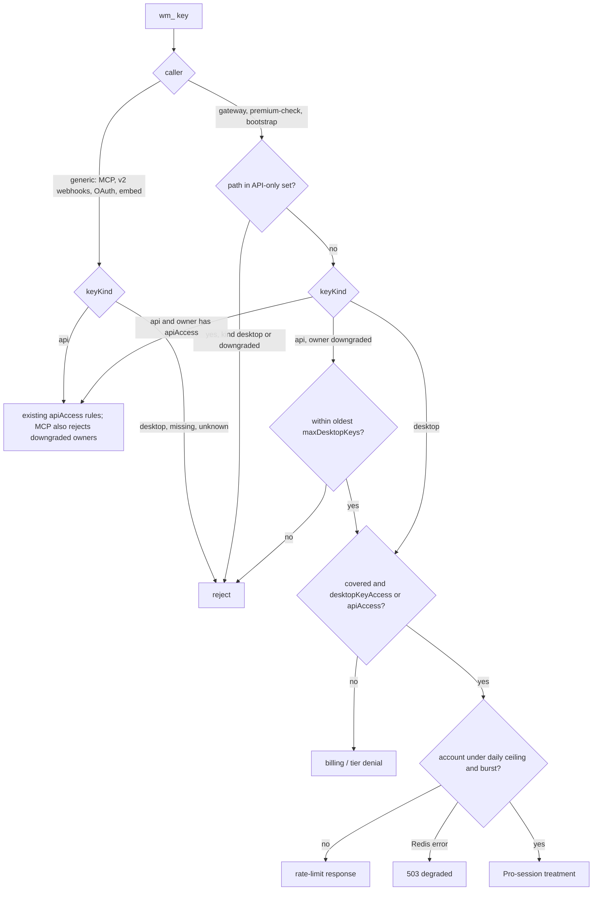

# Pro Desktop Key - Plan

## Goal Capsule

Let Pro and Pro Business subscribers create a **desktop key**: a `wm_` key that gives the official desktop app or a self-built desktop copy the same cloud data a signed-in Pro dashboard gets, minus every API-plan surface.
Authority: this plan's Product Contract, then repo `AGENTS.md`, then existing gateway and entitlement conventions.
Execution is sequential on one branch; this plan does not authorize production writes, Convex deploys, merges, or auto-merge. The Deploy Order below is a hand-off instruction for whoever deploys.
Stop when every unit's tests pass, the Verification Contract gates are green on a ready PR, and the boundary tests prove a desktop key cannot reach any path in the API-only set.

---

## Product Contract

### Summary

Pro and Pro Business accounts can create desktop keys in Settings. A desktop key unlocks what a signed-in Pro session unlocks, except the named API-only surfaces, under a per-account daily ceiling and key limit, and stops working when the subscription ends. Pricing, desktop settings, and docs say this plainly, including that the key is for the subscriber's own use.

### Problem Frame

Pro has no key. The official desktop app works around that with browser sign-in (#9401, #9424), but a self-built copy has no route to Pro cloud data short of API Starter at $99.99/month. The desktop settings still lead with a "License / API Key" box and a "Not set" warning, which tells Pro buyers they need something their plan cannot produce. A customer bought Pro on 2026-10-24 expecting a key for their own copy and asked for a refund the next day.

This makes Pro, not a new tier, the supported way for a self-built copy to get cloud data for one named user; shared or public deployments stay on the API plans.

### Requirements

- R1. Pro and Pro Business owners with active coverage can create desktop keys; free accounts and lapsed subscribers cannot. Pro rows written before this change qualify.
- R2. The product name is **desktop key** everywhere a user sees it. Copy states it works in the official desktop app and self-built desktop copies, for the subscriber only; shared or public deployments need an API plan.
- R3. A desktop key reaches what a signed-in Pro session reaches — on the gateway, in handler-level premium checks, and in bootstrap — decided by the same entitlement checks, minus the API-only set in R4.
- R4. A desktop key never reaches the API-only set: every `/api/v2/` path, shipping webhooks, MCP via `wm_` key, and OAuth key grants. The set is named in one place and pinned by tests.
- R5. Key limits per account: Pro 2, Pro Business 3. A downgraded owner's still-working generic keys count toward the same cap.
- R6. Each account's desktop-key traffic has a daily ceiling and a per-minute burst limit, so a desktop key cannot serve as a backend for other applications.
- R7. A desktop key keeps the existing `wm_` shape; its kind is stored server-side.
- R8. A key's kind is fixed at creation and decides its scope before the owner's plan does. A desktop key stays desktop-scope even if its owner upgrades to an API plan. An API-plan owner who drops to Pro keeps their keys at desktop scope, up to the cap.
- R9. When coverage ends, desktop keys are denied, not revoked; renewing restores them. Revocation and one-time display of the full key work as for API keys.
- R10. Pricing copy, desktop settings copy, and docs describe desktop keys and correct the stale claims about desktop key requirements and subscriber access.

### Acceptance Examples

- AE1. A Pro user creates a desktop key, pastes it into a desktop build with no sign-in, and Pro panels load non-empty data from the cloud.
- AE2. The same key sent to any `/api/v2/` path, a shipping webhook route, the MCP endpoint, or OAuth authorize is rejected.
- AE3. A Pro user with two active desktop keys tries to create a third and sees a limit message naming the cap.
- AE4. A Pro subscription lapses; the next request with that desktop key gets the same billing denial a lapsed API key gets; renewal restores it without a new key.
- AE5. An account past its daily ceiling gets a rate-limit response until the next UTC day, on both RPC routes and bootstrap; revoking and recreating a key does not reset it.
- AE6. An API Starter customer with three keys downgrades to Pro: two keep Pro dashboard data, the third is denied until one is revoked, and all lose REST v2 and MCP via key.
- AE7. A Pro owner upgrades to API Starter: their desktop key keeps Pro access and still cannot reach REST v2.

### Scope Boundaries

- Out: OAuth device flow, a separate self-host plan, and handling the triggering refund.
- Out: changing API Starter or API Business keys, limits, or prices.
- Out: desktop keys for the free tier, for Clerk-role-only Pro grants without an entitlement row, and for the OpenSky desktop relay, which stays enterprise-key only.
- Out: Docker self-host. Docker mode disables cloud fallback by policy (`src-tauri/sidecar/local-api-server.mjs`), so a key there never reaches the cloud; the policy stays and copy says Docker copies run on their own data.

#### Deferred to Follow-Up Work

- A distinct visible prefix for desktop keys, if support needs kind-at-a-glance.
- Per-device binding beyond the count limit.

### Decisions

- D1 (2026-10-25). Desktop builds only; Docker self-host keeps cloud fallback off.
- D2 (2026-10-25). The daily ceiling is sized to measured real use, even above API Starter's 1,000 requests/day. API Starter stays distinct through REST v2, SDKs, MCP by key, and its commercial licence.

---

## Planning Contract

### Key Technical Decisions

- **KTD1. Follow the embed-key pattern for the entitlement.** Add a named `desktopKeyAccess` flag plus `maxDesktopKeys`, `desktopKeyRequestsPerDay` and `desktopKeyBurstPerMinute`, with one predicate in `shared/desktop-key-access.js` plus `.d.ts` so Convex, edge TypeScript, and the self-contained `api/*.js` files all import it. True for Pro and Pro Business; false for free, API plans, and Enterprise. Callers merge features with `mergeEntitlementFeatures` first, as `convex/embedKeys.ts` does, so pre-change rows qualify. The three limits are plan structure: catalog values win over stored rows, as `mcpCallsPerDay` already does.
- **KTD2. Store the kind as an explicit `keyKind` of `api` or `desktop`.** A new column, not `scopes`, which is reserved for Company Monitoring. Convex maps legacy rows to `api` at the source, so every validate response and cache write carries an explicit kind.
- **KTD3. Fail closed on any kind but `api`.** Generic validators in `server/_shared/user-api-key.ts` and `api/_user-api-key.js` accept only `keyKind === 'api'`; missing or unknown values are re-validated, never trusted. Desktop-aware variants return the principal with its kind and key hash. Three surfaces opt in: the gateway, bootstrap, and `server/_shared/premium-check.ts`.
- **KTD4. Kind routes before plan.** In the gateway's #4611 gate and in premium-check, a desktop key never enters the `apiAccess` branch. It is admitted when the owner has coverage and either `desktopKeyAccess` or `apiAccess` (R8 upgrade case), then gets Pro-session treatment, desktop limits, and `rateLimitPrincipalUserId` set to the owner. Desktop principals skip the #3199 REST meter.
- **KTD5. Downgraded API keys become desktop-scope at request time.** A generic key whose owner lacks `apiAccess` but passes the desktop predicate is treated as a desktop principal on the gateway, premium-check, and bootstrap, and is rejected by MCP's `wm_` path. Only the owner's oldest active keys up to `maxDesktopKeys` qualify; the rest are denied, not revoked. No row is rewritten, so an upgrade restores full API access.
- **KTD6. Meter per account, fail closed, measure across all routes.** One counter per owner userId and UTC date, matching the #3199 rule that user keys meter on userId so an allowance cannot be multiplied; plus a per-minute burst bucket. A Redis error returns the existing rate-limit-degraded 503 with Retry-After. Size the ceiling from Axiom as the larger of two p99 daily per-principal totals across all routes: existing `wm_` key traffic (attributed on every route) and signed-in Pro desktop sessions. Ceiling = 3 x the larger p99, rounded up (D2); record both numbers and the result in the PR.
- **KTD7. One named API-only set.** The gateway has no tier above 1, and a Pro session reaches `/api/v2/shipping/route-intelligence` today, so "same checks" alone would open REST v2. A single exported set — the `/api/v2/` prefix plus the MCP and OAuth edges — is denied for desktop principals in the gateway and premium-check.
- **KTD8. Keep the cache key name; add a version field.** Both validators write a cache-version field. A hit without it re-fetches from Convex instead of returning 401 or trusting it, so existing API customers see no 401 window and revocation, lifecycle invalidation, and account deletion keep deleting the same `user-api-key:<hash>` name.

### High-Level Technical Design

### Deploy Order

1. Ship the edge validators, gateway, premium-check, and bootstrap changes (U3, U4) with desktop creation still impossible.
2. Deploy the Convex schema and validate-by-hash changes (U2) with desktop creation behind a Convex env flag, off.
3. Confirm the edge is live in production, then flip the flag. Rolling the edge back requires flipping the flag off first.

### Assumptions

- The desktop sidecar forwards the stored key on every cloud call when cloud fallback is on, which it is for desktop builds (`src-tauri/src/main.rs`), so the official app needs copy changes, not transport changes.

### Sources & Research

- Key creation gate and limits: `convex/apiKeys.ts` (`createApiKey`, `MAX_KEYS_PER_USER = 5`).
- Non-generic principal precedent: `server/_shared/user-api-key.ts`, `api/_user-api-key.js`.
- Handler-level premium check requiring `apiAccess`: `server/_shared/premium-check.ts` (`resolvePremiumCallerIdentity`).
- Gateway user-key gate and REST meter: `server/gateway.ts` (#4611, #3199).
- Tier map with no entry above tier 1: `server/_shared/entitlement-check.ts`; Pro-reachable v2 path: `src/shared/premium-paths.ts`.
- Named-flag precedent and merge rule: `shared/embed-access.ts`, `convex/embedKeys.ts`, `convex/lib/entitlements.ts`.
- Docker fallback policy: `src-tauri/sidecar/local-api-server.mjs` (`resolveConfig`).

---

## Implementation Units

### U1. Catalog flag, limits, and shared predicate

**Goal:** Plans declare who may hold desktop keys, how many, and the limits.
**Requirements:** R1, R5, R6
**Dependencies:** none
**Files:** `convex/config/productCatalog.ts`, `convex/lib/entitlements.ts`, `shared/desktop-key-access.js` (new), `shared/desktop-key-access.d.ts` (new), `scripts/generate-entitlement-crosswalk.mjs`, `api/_product-catalog.generated.js` (regenerated), `tests/desktop-key-access.test.mts` (new)
**Approach:** Add the KTD1 fields and predicate; make the three limits catalog-wins in the merge; register them in the crosswalk. Run the KTD6 measurement and set the ceiling from it.
**Patterns to follow:** `shared/embed-access.ts`, `shared/bootstrap-tier-keys.js` for the `.js` + `.d.ts` pairing.
**Test scenarios:**
- Pro and Pro Business grant access with limits 2 and 3; free, both API plans, and Enterprise do not.
- A Pro row stored without `desktopKeyAccess` passes after merge.
- A stored row with an old ceiling resolves to the current catalog ceiling.
- Expired `validUntil` is denied.
- Crosswalk lists the capability against both Pro plans.
**Verification:** The predicate is the only place the rule is written, and every caller imports it.

### U2. Convex key kind, creation, and limits

**Goal:** Pro owners can create, list, and revoke desktop keys.
**Requirements:** R1, R5, R7, R8, R9
**Dependencies:** U1
**Files:** `convex/schema.ts`, `convex/apiKeys.ts`, the existing apiKeys test file under `convex/__tests__/`
**Approach:** Add `keyKind` (KTD2). Creation takes a requested kind; `desktop` checks the merged predicate behind the Deploy Order flag and counts active desktop keys plus active generic keys of an owner without `apiAccess` against `maxDesktopKeys`. Desktop keys reject Company Monitoring scopes. List and validate-by-hash return an explicit kind.
**Test scenarios:**
- Covers AE3. Third desktop key on Pro fails with the limit error; Pro Business stops at three.
- Downgraded owner with three generic keys cannot create a desktop key.
- Free, lapsed Pro, and API Starter owners cannot create a desktop key; Pro still cannot create an `api` key.
- Flag off: desktop creation refused for everyone.
- Validate-by-hash returns `desktop` for new rows and `api` for legacy rows.
- Revoking a desktop key frees a slot.
**Verification:** Convex suite passes; schema change is additive.

### U3. Validators fail closed

**Goal:** Every generic `wm_` consumer rejects anything but an explicit `api` key.
**Requirements:** R4, R7
**Dependencies:** U2
**Files:** `server/_shared/user-api-key.ts`, `api/_user-api-key.js`, `api/invalidate-user-api-key-cache.ts`, `convex/payments/cacheActions.ts`, `convex/accountDeletion/sideEffects.ts`, `tests/user-api-key-desktop-kind.test.mts` (new)
**Approach:** Apply KTD3 and KTD8. Normalize both cache producers to write `keyId`, `keyKind`, and the version field. Add desktop-aware variants returning kind and key hash, and a desktop variant of the bootstrap entitlement check that uses the U1 predicate. Confirm the three invalidation sites still delete the same key name.
**Test scenarios:**
- Covers AE2. Generic validator rejects a desktop key from cold and from a cache written by the desktop-aware variant.
- Entries with missing or unknown `keyKind` are re-validated and never granted.
- A pre-change generic entry still authenticates through re-fetch, with no 401 window.
- Revocation clears the entry for a desktop key.
- Convex outage still yields the retryable 503.
**Verification:** Generic callers stay unchanged and reject desktop keys: `api/mcp/auth.ts`, `api/v2/shipping/webhooks/*`, `server/worldmonitor/shipping/v2/register-webhook.ts`, `server/worldmonitor/shipping/v2/list-webhooks.ts`, `api/_oauth-token.js`, `api/oauth/authorize.js`, `api/embed/entitlement.ts`, `server/_shared/embed-entitlement.ts`, `api/telegram-feed.js`.

### U4. Gateway, premium-check, and bootstrap accept desktop principals

**Goal:** A desktop key alone gets non-empty Pro data on the gateway, in handlers, and in bootstrap, under the account limits.
**Requirements:** R3, R4, R5, R6, R8, R9
**Dependencies:** U1, U3
**Files:** `server/gateway.ts`, `server/_shared/premium-check.ts`, `server/_shared/api-only-paths.ts` (new), `api/bootstrap.js`, `api/mcp/auth.ts`, `tests/gateway-desktop-key.test.mts` (new), the existing premium-check and bootstrap auth test files
**Approach:** Add the KTD7 set. Apply KTD4 and KTD5 in the gateway and in `resolvePremiumCallerIdentity`, returning Pro LLM limits for desktop principals. MCP's `wm_` path rejects downgraded owners. Add the KTD6 account counter and burst bucket, charged by the gateway and bootstrap. Bootstrap serves a desktop principal what it serves a signed-in Pro session.
**Execution note:** Write failing tests for AE1, AE2, and AE6 before changing any gate.
**Test scenarios:**
- Covers AE1. Desktop key, no bearer, on get-country-intel-brief, get-route-impact, and summarize-article returns non-empty payloads, not just 200.
- Covers AE2. Desktop key on every path in the API-only set, including `/api/v2/shipping/route-intelligence`, is denied.
- Covers AE4. Lapsed owner gets the billing denial; renewal restores the same key.
- Covers AE5. Account past the ceiling gets 429 with Retry-After at the next UTC day on RPC and bootstrap; two keys of one owner share the counter; revoke-and-recreate does not reset it.
- Burst bucket rejects the request over the per-minute limit.
- Redis counter error returns the degraded 503.
- Covers AE6. Downgraded owner's oldest keys get Pro access; the key beyond the cap is denied; all are refused by MCP and REST v2.
- Covers AE7. Desktop key of an API Starter owner keeps Pro access and is denied REST v2.
- Desktop principal is not charged to the #3199 meter and is attributed to the owner in rate limiting.
- Entitlement lookup outage returns the retryable 503.
**Verification:** Gateway, premium-check, MCP auth, and bootstrap suites pass.

### U5. Web settings: desktop keys

**Goal:** Pro owners create and manage desktop keys on the web dashboard.
**Requirements:** R1, R2, R5, R8, R9
**Dependencies:** U2
**Files:** `src/components/UnifiedSettings.ts`, `src/services/api-keys.ts`, `src/locales/en.json`, the existing UnifiedSettings DOM test under `tests/dom/`
**Approach:** Pro and Pro Business owners see a "Desktop keys" section: create, one-time full-key display, list, revoke, used/limit count, and a one-line use note (R2). Downgraded owners' generic keys appear there with revoke only, marked as desktop access. API-plan owners see the existing API keys section; free owners see an upgrade prompt naming desktop keys.
**Test scenarios:**
- Pro owner sees the desktop section, not the API key create form.
- Full key shows once; the list then shows the prefix.
- At the limit, create is disabled with the cap named.
- Downgraded owner sees old keys with revoke and no create.
- Free owner sees the upgrade prompt.
**Verification:** Browser check per `verify-worldmonitor`, with screenshots for the PR.

### U6. Desktop settings copy

**Goal:** The desktop app stops telling Pro users they need an API key.
**Requirements:** R2, R10
**Dependencies:** U2
**Files:** `src/settings-main.ts`, `src/services/settings-constants.ts`, `src/locales/en.json`, the existing settings DOM test under `tests/dom/`
**Approach:** Rename the box to "Desktop key". Sign in leads for Pro; the key field follows as the alternative for builds without sign-in, noting API-plan keys also work. No warning badge when signed in to a paid account or when a free account has no key.
**Test scenarios:**
- Signed-in Pro user with no key sees no warning badge.
- A saved key shows "Active".
- Free signed-out user sees sign-in first and the key as optional.
**Verification:** Settings render checked in the browser harness, with screenshots for the PR.

### U7. Pricing and docs

**Goal:** Buyers learn what desktop keys are, and their limits, before checkout.
**Requirements:** R2, R10
**Dependencies:** U1
**Files:** `convex/config/productCatalog.ts` (Pro and Pro Business marketing features), `api/_product-catalog.generated.js`, `pro-test/src/locales/en.json` (self-host FAQ), `docs/api-keys.mdx`, `docs/desktop-app.mdx`, `docs/desktop-parity-matrix.md`, `docs/api-key-deployment.mdx`, `docs/pricing.mdx`, `docs/architecture/pro-monetization.md`, `SELF_HOSTING.md`
**Approach:** Add "Desktop key for the desktop app" with the key count to both Pro plans. Docs state the API-only set, the single-user rule, that the key lives in the desktop keychain, and that shared or public deployments need an API plan. Correct the parity matrix's "blocked for subscribers" row and the "local-only without a key" claim. Docker copies are described as running on their own data (D1).
**Test expectation:** none -- copy and docs; covered by the docs build and catalog generation.
**Verification:** Docs build passes; generated catalog matches source.

---

## Verification Contract

- `npm run typecheck` and `npm run typecheck:api`.
- `npm run test:data`, `npm run test:sidecar`, `npm run test:convex`, and `npm run test:dom`.
- `npm run lint:boundaries`.
- Crosswalk and catalog regeneration produce no diff beyond this change.
- Browser check of U5 and U6 per `.agents/skills/verify-worldmonitor/SKILL.md`, with screenshots attached to the PR.
- `git diff --check`.

## Definition of Done

- Every unit's scenarios exist and pass; AE1–AE7 each have a named test.
- The KTD6 measurements and the resulting ceiling are recorded in the PR body.
- Generic validator callers changed only to reject non-`api` keys.
- Copy uses "desktop key" consistently and states the single-user rule.
- Abandoned-attempt code is removed from the diff.
- A ready PR exists against `main` with required checks green; it is not merged; the Deploy Order is in the PR body.
