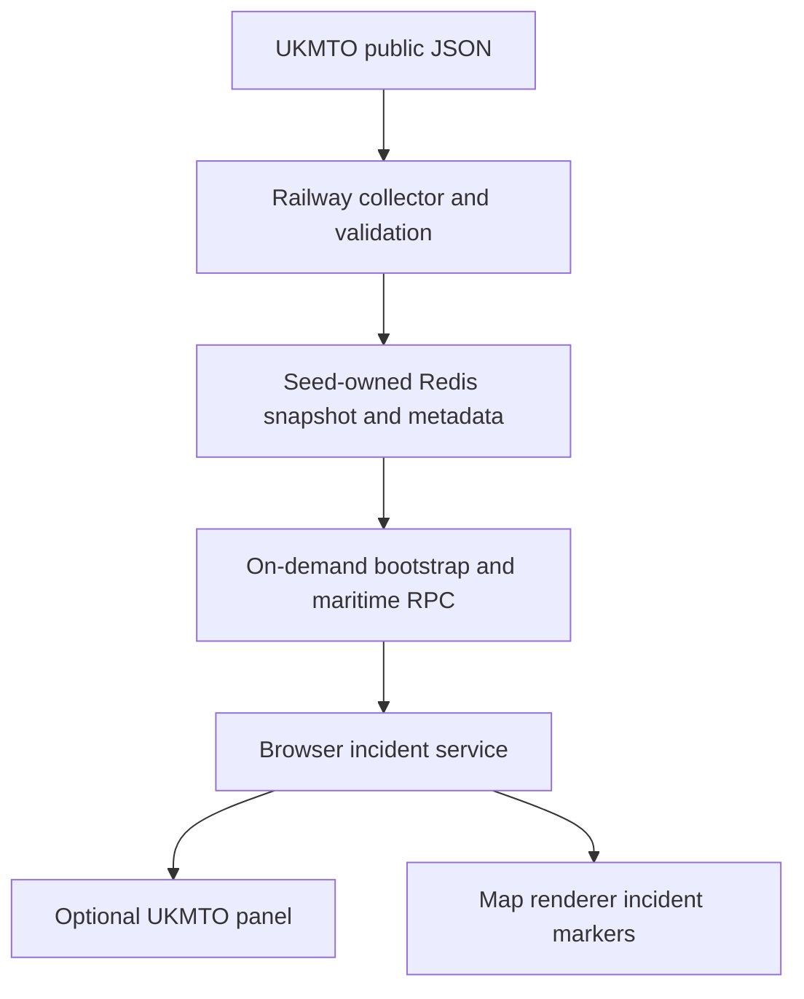
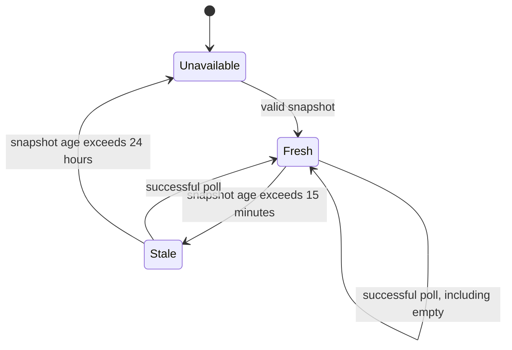

# UKMTO Maritime Incidents - Plan

## Goal Capsule

Add UKMTO incident reports to WorldMonitor's maritime map and an optional incident list.
Deliver a verified PR. Merge, deployment and external correspondence need separate authorization.
Implementation uses the public JSON service behind UKMTO's website. It is not a documented supported developer API.

---
## Product Contract

### Summary and problem frame

WorldMonitor has AIS traffic and NGA navigation warnings, but lacks direct UKMTO incident reports.
Users need to see reported attacks, suspicious activity and advisories with original attribution, geography and dates.

### Requirements

- R1. Fetch UKMTO's public incident dataset centrally every five minutes, without browser requests to the publisher.
- R2. Preserve stable incident identity, type, narrative, coordinates, incident time and publication time. A repeated or revised report replaces the same ID.
- R3. Separate fresh, stale, unavailable and confirmed-empty data. Successful retrieval time must not imply a recent incident or a confirmed attack.
- R4. Show incident markers with the existing ship-traffic layer and an optional UKMTO list. List selection centers the map. Render safely on desktop and mobile.
- R5. Link to UKMTO, preserve claim language, and do not interpret reporting-delay pin colors as severity.
- R6. Keep NGA, cable analysis, AIS readiness and chokepoint scores unchanged.
- R7. Expose the same incident dataset through the maritime RPC for API consumers and register source health.

### Scope boundaries

No Iranian feed changes, notifications, historical backfill, risk scoring, publisher correspondence or deployment.
Automated incident verification and historical revision archives are deferred to follow-up work.

### Acceptance examples

- AE1. A report with a suspected projectile strike appears with UKMTO's wording and both dates. Re-fetching its ID produces one row and one marker.
- AE2. A failed poll retains the last valid payload without changing its retrieval time. After 15 minutes the UI marks it stale. After 24 hours it is unavailable.
- AE3. A valid empty array is a successful empty result. A malformed response does not replace a prior valid dataset.
- AE4. Disabling the ship-traffic layer hides incident markers. Switching map renderers preserves the current incident set.

---
## Planning Contract

### Key technical decisions

- KTD1. Use `https://sccd.royalnavy.mod.uk/api/ukmto/all`, observed in the official website's JavaScript and verified as JSON. UKMTO's terms sections 20-23 describe licensed reuse and third-party feeds. No API SLA, versioning or polling allowance was found. Five minutes is an initial operational choice, not a publisher guarantee.
- KTD2. Add a dedicated incident RPC and seed-owned key. Extending NGA warnings would leak incident semantics into cable analysis and change the existing availability contract.
- KTD3. Normalize one typed incident model at the upstream boundary. Reject malformed records and conflicting duplicate IDs as a failed snapshot. Accept unknown type names as text. Do not invent severity from pin color or absent coordinates.
- KTD4. Keep one last-valid snapshot for 24 hours and grade freshness from its original fetchedAt. Run-seed metadata describes polling health independently. Do not use incident age to decide feed health because incidents are irregular.
- KTD5. Load through the on-demand bootstrap path when the optional list or ship layer needs it. Retain and age the last valid browser snapshot on bootstrap miss; retrying the RPC would read the same Redis key. The RPC independently serves API clients without CDN caching.
- KTD6. Add renderer-specific markers under the existing ship-traffic layer, separate from AIS disruption objects. Do not mark AIS healthy because UKMTO has data.

### High-Level Technical Design

### Alternatives considered

Adding UKMTO to NGA warnings is smaller but changes downstream meaning and availability.
Fetching directly in an Edge handler makes upstream load depend on requests and conflicts with seed ownership.
A separate seed and RPC isolates failures and reuses the repository's producer/reader pattern.

---
## Implementation Units

### U1. Validate and collect incidents

**Goal:** Publish a bounded last-valid UKMTO snapshot. **Requirements:** R1-R3, R5, AE1-AE3. **Dependencies:** None.

**Files:** `scripts/seed-ukmto-incidents.mjs`, `scripts/railway-services.json`, `tests/ukmto-incidents.test.mjs`, `tests/fixtures/ukmto-incidents.json`.

**Approach:** Use `runSeed`, `loadEnvFile`, timeout-bound fetch and a User-Agent. Retain stable sitecore IDs, two distinct dates, coordinates, type, place and narrative. Sort newest incident first. Poll every five minutes. Retain payload for 24 hours; failed validation cannot publish. Register the service as planned until deployment is authorized.

**Patterns:** `scripts/seed-displacement-summary.mjs`, `scripts/_seed-utils.mjs`.

**Execution note:** Write parser and fetch-contract tests first.

**Test scenarios:** Valid reports preserve dates and narrative; repeated IDs deduplicate; conflicting duplicates fail; invalid coordinates/dates/IDs and non-array payloads fail; empty arrays succeed; HTTP failures and timeouts do not publish; input HTML stays text.

**Verification:** Fixture and HTTP-contract tests pass without production writes.

### U2. Expose cached incidents and source health

**Goal:** Serve incidents without changing NGA behavior. **Requirements:** R3, R6-R7, AE2-AE3. **Dependencies:** U1.

**Files:** `proto/worldmonitor/maritime/v1/list_ukmto_incidents.proto`, `proto/worldmonitor/maritime/v1/service.proto`, generated maritime client/server and OpenAPI artifacts, `server/worldmonitor/maritime/v1/list-ukmto-incidents.ts`, `server/worldmonitor/maritime/v1/handler.ts`, `server/gateway.ts`, `shared/bootstrap-tier-keys.js`, generated bootstrap registry, `api/bootstrap.js`, `api/health.js`, `tests/ukmto-incidents-handler.test.mts`.

**Approach:** Read the bare seed-owned key. Return incidents, fetchedAt and availability/staleness fields. Bound responses and reject malformed cache shapes. Add an on-demand bootstrap entry with a short CDN cache budget. Keep UKMTO health independent. Regenerate contracts with pinned sebuf tooling.

**Patterns:** `server/worldmonitor/radiation/v1/list-radiation-observations.ts`, `shared/bootstrap-tier-keys.js`.

**Test scenarios:** Fresh, stale, expired, missing and empty snapshots; future or malformed clocks; no upstream fetch on miss; reader uses raw seed namespace; NGA response unchanged; bootstrap key stays out of eager tiers.

**Verification:** Producer-to-reader fixtures, API typecheck, generated freshness and bootstrap/health checks pass.

### U3. Display incident list and map markers

**Goal:** Users can inspect and locate UKMTO reports. **Requirements:** R2-R6, AE1-AE4. **Dependencies:** U2.

**Files:** `src/services/ukmto-incidents.ts`, `src/components/UkmtoIncidentsPanel.ts`, `src/config/panels.ts`, `src/app/panel-layout.ts`, `src/app/data-loader.ts`, `src/App.ts`, `src/components/MapContainer.ts`, `src/components/DeckGLMap.ts`, `src/components/Map.ts`, `src/components/GlobeMap.ts`, relevant locale/style files, `tests/ukmto-incidents-service.test.mts`, `tests/dom/ukmto-incidents-panel.test.ts`, `e2e/ukmto-incidents.spec.ts`.

**Approach:** Optional panel using existing lazy-panel registration, loadable on any variant where users enable it. UKMTO map loading remains tied to the full dashboard Ships layer. Refresh only when the panel or ship layer is enabled. Render narrative as escaped text with a fixed UKMTO source link. Cache the dataset in MapContainer for renderer changes. Markers expose location/type, while the panel provides the full report and source age. Keep AIS readiness independent.

**Patterns:** `ClimateAnomalyPanel`, `MapContainer.setAisData`, existing map marker methods and refresh registrations.

**Test scenarios:** Empty versus unavailable; stale badge and original retrieval time; duplicate refresh; HTML escaping; keyboard and pointer row activation; marker visibility follows ship layer; renderer change retains data; mobile layout fits; disabled consumers avoid requests.

**Verification:** Focused DOM/service tests, browser proof, desktop/mobile screenshots, frontend typecheck and import boundaries pass.

### U4. Document and deliver

**Goal:** Maintainers can operate the source and reviewers can inspect evidence. **Requirements:** R1-R7. **Dependencies:** U1-U3.

**Files:** `docs/maritime-intelligence.mdx`, `docs/railway-seed-consolidation-runbook.md`, source-attribution declarations/generated ledger as required by its generator.

**Approach:** Document endpoint support limits, polling, retention, field semantics, deployment prerequisites, health and attribution. Record explicit production evidence limits. Attach rendered UI screenshots to the PR.

**Test scenarios:** Existing documentation and attribution checks validate references and generated registry coverage.

**Verification:** Focused tests and required CI pass on the PR head. Production activation remains separate.

---
## Verification Contract

Run focused Node producer tests and handler/service tests before broad gates.
Run `npm run typecheck`, `npm run typecheck:api`, `npm run lint:boundaries`, `npm run docs:check`, `npm run test:railway-registry` and `git diff --check` where applicable.
Regenerate proto and bootstrap artifacts with the repository tools, then verify the generated diff.
Use the existing Playwright setup with controlled UKMTO responses. Capture desktop/mobile evidence and inspect actual rendering.
Local browser proof does not establish deployed Edge behavior or a natural Railway run.

---
## Definition of Done

All requirements have focused proof. UI screenshots appear in the PR description.
No unrelated changes, experimental code or unverified success claims remain.
The PR has required CI results for its current head; blocked checks are reported explicitly.
No merge, deployment, or production seed execution occurs under this task's authority.

---
## Risks and operational notes

UKMTO can change its undocumented website endpoint. Validation must fail visibly and preserve the prior snapshot.
A successful empty response cannot prove upstream completeness; display it as no reports returned, not no maritime threats.
Publisher contact for a supported feed is deferred and requires explicit message authorization.
The Railway service is planned until separately provisioned; local delivery must not claim live coverage.

## Sources

- https://www.ukmto.org/recent-incidents
- https://sccd.royalnavy.mod.uk/api/ukmto/all
- https://www.ukmto.org/terms-and-conditions
- `CONCEPTS.md` Seed-Owned Key, Last-Good Snapshot and Seed-Meta Record.
- `docs/solutions/logic-errors/mcp-freshness-ignored-seed-meta-error-status.md`.
