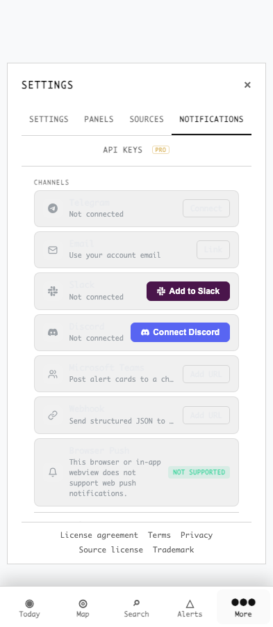
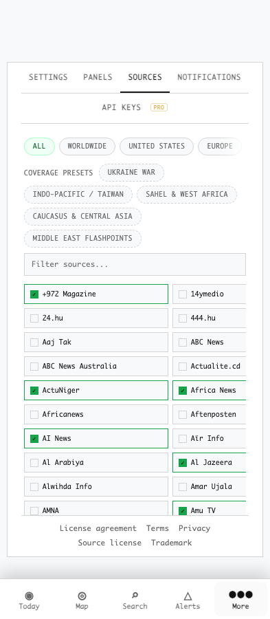
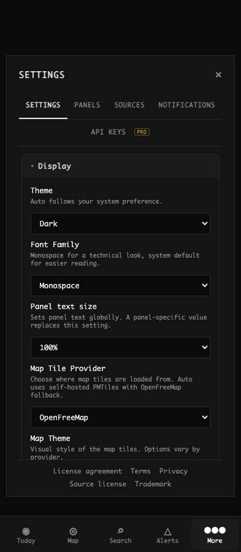
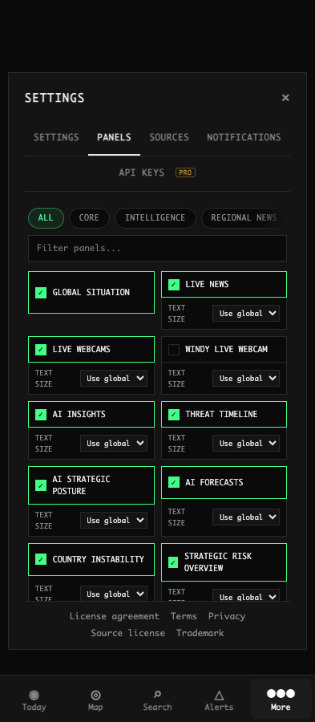
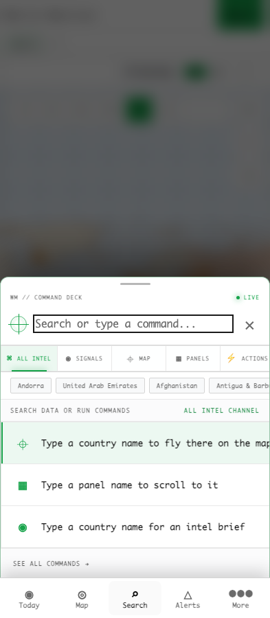
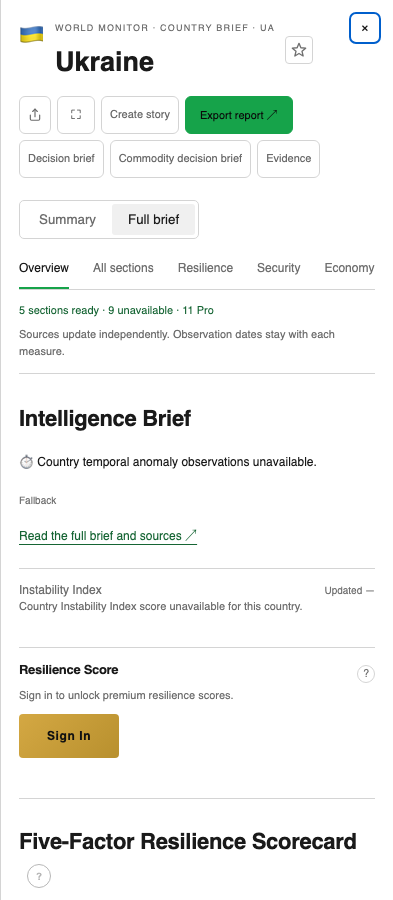
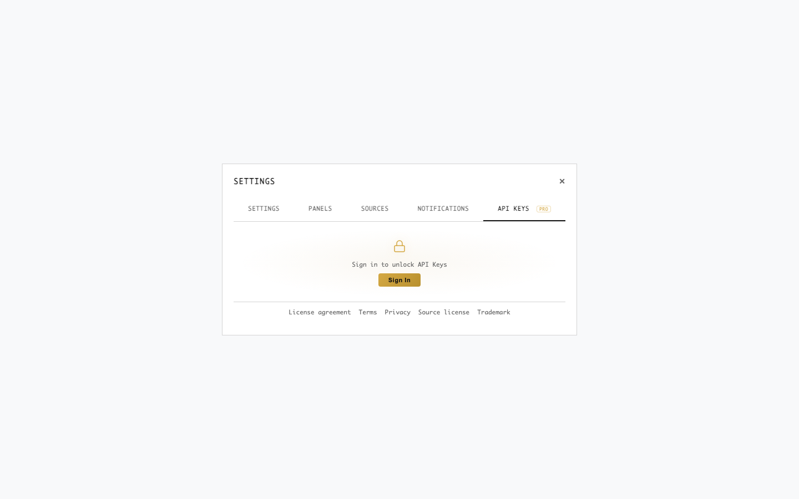
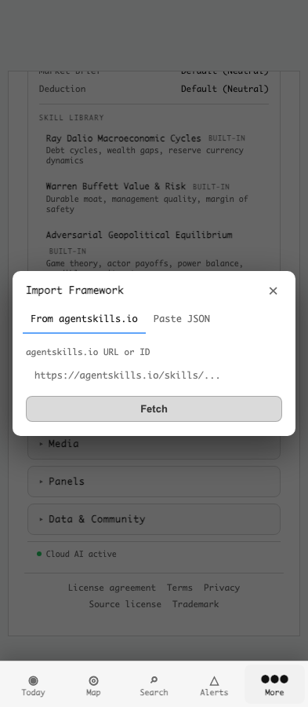

# Dashboard UI design sweep — 7 November 2026

This review identifies eight improvements in existing dashboard UI. The first three address measured readability or interaction problems. The remaining five are design recommendations. This PR changes review documentation and evidence only; it implements none of the proposed repairs.

Reviewed source: `0b5cb13bfb74e7619790f3e9e7fbfbfe8026744d` on `main`. The install-sheet redesign in PR #10276 is separate and excluded from this backlog.

## Prioritized findings

Priority is relative to this sweep: P1 = repair soon because reading or operating the interface is impaired; P2 = meaningful usability improvement; P3 = visual consistency polish. No P0 was observed. Screenshots are unmodified local browser captures; click for full size.

| ID / priority | Surface and evidence | Observation and user impact | Proposed scoped improvement | Owner and acceptance check |
| --- | --- | --- | --- | --- |
| UI-01 · **P1** | Notifications, light theme · controlled Pro/account fixture  | Channel names use `#e8eaed` on `#f0f0f0`, approximately **1.06:1** contrast. Several labels and neutral actions nearly disappear. This is a measured theme defect, not an empty-account or loading state. [Dark comparison](assets/2026-11-07-ui-sweep/notifications-pro-dark-393.png). | Replace hardcoded `--settings-text` and secondary text colors with theme-aware semantic tokens. Check neutral buttons and status text in the same scope. Preserve provider colors only where they retain contrast. | `src/styles/main.css`: notification `--settings-*` tokens and `.us-notif-ch-*`; `src/services/notifications-settings.ts`. Verify normal text contrast, empty/connected/unsupported rows, both themes and both widths. |
| UI-02 · **P1** | Sources picker, phone  | At 393px, `.sources-toggle-grid` has **323px client width and 402px scroll width**. Intrinsic grid tracks measure about 210px and 186px. The second column is clipped. Source rows are also only 29px high. [Desktop comparison](assets/2026-11-07-ui-sweep/settings-sources-dark-1440.png). | Allow grid tracks/items to shrink and wrap labels; use one readable column at narrow widths if needed. Keep region filters visibly scrollable and give source toggles a 44px phone target. | `src/styles/main.css`: `.sources-toggle-grid`, `.source-toggle-item`, `.source-toggle-label`; `src/components/UnifiedSettings.ts`. At 320/393px and enlarged text, assert scroll width does not exceed client width; toggle a long source name and verify persistence. |
| UI-03 · **P1** | Shared close controls and phone Settings  | Settings' visible close button measures **12×23px**. Mission close is 24×24px; mobile search close is approximately 29×34px. These are element bounds, not just glyph sizes. No enlarged pseudo-element hit target is defined in their owning rules. | Keep the quiet visual glyph but give each control a 44×44px non-overlapping phone hit area, an accessible name and visible focus. Preserve each surface's dismissal and focus-return contract. | `src/styles/main.css`: `.modal-close`, `.mission-preset-close`, `.search-sheet-cancel`. Verify tap near each target edge, Tab/Shift+Tab, Escape and opener focus; check stacked Settings/import dismissal. |
| UI-04 · **P2** | Panels picker  | Every panel repeats a bordered enable control plus a text-size row. The select is **21px high** and its label is 9px at default scale. On phones the two-column grid wraps names unevenly and gives secondary typography settings similar visual weight to panel selection. [Desktop comparison](assets/2026-11-07-ui-sweep/settings-panels-dark-1440.png). | Prioritize the enable row, move per-panel text size behind a secondary disclosure, and use a single-column phone layout where long labels need it. Retain a visible indication when an override differs from global text size. | `src/components/UnifiedSettings.ts`; `src/styles/main.css`: `.panel-settings-item`, `.panel-font-scale-control`. Verify enable/disable, live apply, persisted overrides and global-size inheritance in both themes. |
| UI-05 · **P2** | Search / command palette  | Identity/status chrome, five categories, suggestion chips, help rows and footer metadata compete with the search field. Phone chips measure **23px high**, category controls 36px. Technical labels such as “ALL INTEL CHANNEL” add reading without clarifying the next action. [Desktop results](assets/2026-11-07-ui-sweep/search-results-dark-1440.png). | Keep the technical identity, but make the input and results dominant. Reduce redundant readiness/channel text, show fewer relevant starting suggestions and use touch-sized category controls. Preserve keyboard navigation and result grouping. | `src/components/SearchModal.ts`; `src/styles/main.css`: `.search-*`. Verify empty/query/no-results states, keyboard selection, phone cancellation and opening a country result; check the mobile keyboard on a real device. |
| UI-06 · **P2** | Country brief action hierarchy  | On a phone, share, expand, story, report export, two decision briefs and evidence occupy two action rows before mode and section navigation. Export is the strongest colored action even though reading the brief is the primary task. Controls are generally 28–38px high. Unavailable data in this fixture is **not** evidence of a production outage. | Keep reading mode and the most frequent action visible; group secondary creation/export actions into a labeled menu. Preserve immediate access to evidence and make all phone controls touch-sized. | `src/components/CountryDeepDivePanel.ts` and its action/render modules; `src/styles/main.css`. Verify reading, section navigation, sharing, export/locked states and overflow-menu keyboard behavior without losing discoverability. |
| UI-07 · **P2** | Signed-out / upgrade states  | API access shows a small lock, one sentence and a small desktop Sign In button in a large empty modal. Notifications uses a different left-aligned paragraph and upgrade action. Neither layout clearly explains what becomes available next. [Notifications gate](assets/2026-11-07-ui-sweep/settings-notifications-light-393.png). | Use a consistent compact gate: feature heading, one concrete benefit, account/plan requirement and one primary action. Distinguish signing in from purchasing access; keep relevant documentation available. | `src/components/UnifiedSettings.ts`: API-key locked state; `src/services/notifications-settings.ts`: upgrade state. Verify anonymous, signed-in Free and entitled states; ensure every action reaches the intended auth/plan path. |
| UI-08 · **P3** | Framework import popup  | The nested popup uses a different rounded surface, tab accent and button treatment from Settings. Its URL field has weak enclosure in light mode, and the disabled Fetch button occupies most of the visual emphasis. Both themes render correctly; this is consistency and affordance polish, not a demonstrated contrast failure. | Normalize the dialog header, field boundary, focus treatment and button hierarchy against the shared theme tokens. Explain the required URL/ID before Fetch becomes available. Keep the two import methods explicit. | `src/services/preferences-content.ts`; `src/styles/main.css`: `.fw-import-*`. Verify URL and JSON tabs, invalid-input feedback, focus containment and returning to the underlying Settings section. |

## Scope and method

- Full dashboard variant, fresh browser contexts, Chromium, CSS viewports **1440×900** and **393×900**, device scale factor 1, dark and light themes.
- Captured **44 primary states**: desktop/phone dashboard, five Settings tabs, empty/results search, mission picker and country brief; desktop embed dialog; phone More menu. Four additional notification fixtures and four framework-import states bring the total to **52 screenshots**.
- UI reached through actual controls or the documented `/dashboard?country=UA` deep link. Screenshots wait for selected tab state; finite transitions are fast-forwarded for stable captures. Element bounds come from `getBoundingClientRect()`; grid overflow from `clientWidth`/`scrollWidth`.
- API responses were stubbed to empty JSON for isolation. Notification screenshots additionally replace local entitlement presentation with a controlled Pro result and use empty-channel/account fixtures. This exercises the renderer, not real authentication, purchases or notification delivery. No account/production data was changed.
- Deterministic assessment: `npx impeccable --json` on `SearchModal.ts`, `UnifiedSettings.ts` and `panel-layout.ts` returned **zero findings**. It did not detect the measured grid/contrast issues; absence of findings is not a design pass. No detector overlay was injected.
- Visual assessment is a source-and-render review, performed sequentially with the scan. It is not a usability study. Priorities and layout recommendations are reviewer judgments; dimensions and token-derived contrast are reproducible measurements.
- Not verified: native Safari/Android keyboard behavior, screen readers, authenticated billing/key creation, live provider recovery, desktop/Tauri windows, all locales, every map entity popup or every product variant. These require separate scoped follow-up.

## Design assessment

The dashboard has an intentional technical identity, not a generic marketing-template aesthetic. Preserve its density, restrained palette and information-rich character. The primary problem is inconsistent control sizing, theme behavior and hierarchy across surfaces. Search's glow/status decoration and repeated boxed panel controls are the clearest opportunities to reduce visual noise without changing the brand.

What works: Settings groups advanced preferences behind disclosures; mission cards combine a clear name with a useful one-line explanation; country briefs distinguish unavailable data from premium sections. The More menu remains legible in both themes. The embed preview was captured before its data-dependent content settled, so its blank preview is excluded from the defect list.

### Heuristic assessment of the reviewed sample

These subjective 0–4 scores summarize this sample, not the whole product or compliance certification.

| Heuristic | Score | Main reason |
| --- | --- | --- |
| Visibility of system status | 3 | Brief availability labels are explicit; some search status is redundant. |
| Match to users' language | 3 | Missions explain the task; search chrome adds jargon. |
| User control and freedom | 2 | Dismissal exists, but several close targets are too small. |
| Consistency and standards | 2 | Theme tokens and dialog/control treatments diverge. |
| Error prevention | 3 | Framework Fetch is gated; narrow source layout obscures choices. |
| Recognition rather than recall | 2 | Dense grids and crowded toolbars require extra scanning. |
| Flexibility and efficiency | 3 | Search, filtering and keyboard cues support experienced users. |
| Aesthetic and minimalist design | 2 | Secondary controls and search chrome compete with primary content. |
| Error recognition and recovery | 2 | Availability is stated, but recovery flows were not exercised here. |
| Help and documentation | 3 | Contextual descriptions exist; locked states need a clearer next step. |
| **Total** | **25/40** | **Mixed; prioritize measured defects before visual polish.** |

Cognitive-load checklist: three concerns out of eight — competing action groups, repeated secondary controls and insufficient hierarchy. Progressive disclosure, grouping, terminology in mission cards, feedback labels and visible navigation provide useful structure. The main first-time-user risk is choosing among equally weighted controls; the main power-user cost is repeated scanning; the main phone-user risk is hitting small targets or losing clipped content. No abandonment or conversion claim is made without user research.

## Recommended repair sequence

1. Repair UI-01 and UI-02 in separate, small behavior-preserving PRs with light-theme and narrow-grid regression evidence.
2. Normalize touch/focus targets in UI-03, then reuse those rules while simplifying Panels and Search.
3. Redesign the brief action grouping and locked states with before/after desktop/phone captures.
4. Finish with framework-import visual consistency. Avoid a global restyle or a new component system for this backlog.
