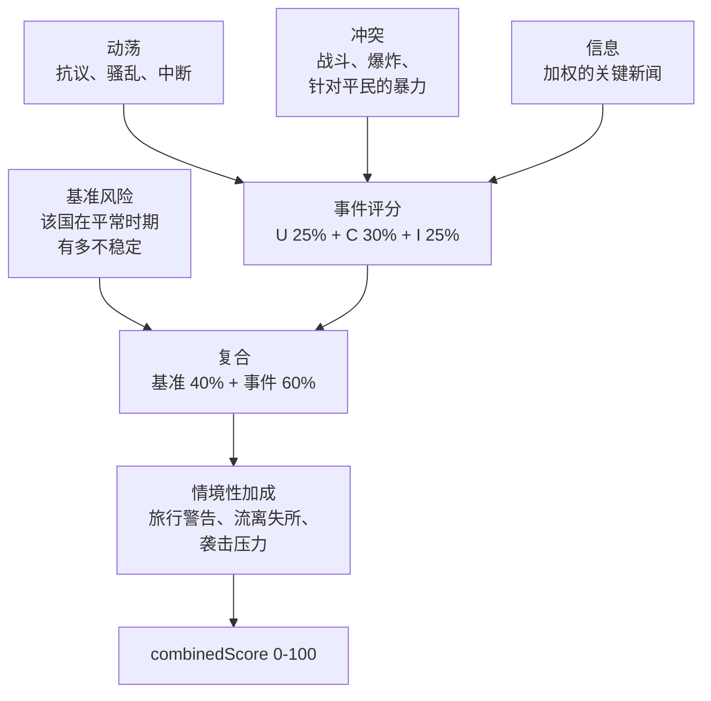

_本方法论由 World Monitor 创始人 [Elie Habib](https://www.worldmonitor.app/blog/authors/elie-habib/) 维护。已发布的修订记录在[更正日志](/zh/corrections)中。_

## 从这里开始

综合不稳定指数回答一个可操作的问题：
**今天我应该先看哪个国家？**

它是一个 0–100 的压力读数，为一份策展的观察名单持续重算。当抗议、交火、军事调动与新闻压力在同一时间、同一地点一起抬头时，这个数字就会上升。

高 CII **不等于**"危险的国家"。它意味着**此地此刻正在发生很多事**。一个稳定国家真正糟糕的一周，得分会高过一个长期动荡国家平静的一周——这正是设计意图：CII 是一个分诊转盘，不是一份判决书。

### 它观察的四件事

| 分量 | 它捕捉什么 |
|---|---|
| **动荡（Unrest）** | 抗议、骚乱，以及随之而来的中断——暴力之前的摩擦。 |
| **冲突（Conflict）** | 真正的交火：战斗、爆炸、针对平民的暴力。 |
| **安全（Security）** | 自 v15 起无输入：其四项输入（外国军机与军舰、航空延误、GPS 干扰）并不衡量该国境内的不稳定，因此该分量读数为 0、权重为 0，直至重建。 |
| **信息（Information）** | 关于这个国家的新闻环境有多热。 |

### 这个数字是怎么拼出来的

每个国家都带有一个**基准值**——它在平常时期有多不稳定——以及一个**事件乘数**，用来决定同一起事件在该国应当推动多大幅度。头条评分是 40% 基准 + 60% 实时事件，再叠加打击、流离失所、旅行警告等情境性加成。

这个 40/60 的比例就是全部设计。它使得一个脆弱国家永远不会读作平静，也使得一个稳定国家真正的危机仍能迅速拉动数字。



### 它是什么，不是什么

**它是**一个帮助值班人员在快速变化的仪表盘上决定先看哪里的单一数字。

**它不是**预测、保险定价输入，也不能替代主权国家发布的旅行警告。它同样**不是**[国家韧性指数](/zh/methodology/country-resilience-index)——后者问的是相反的问题：不是*这个国家正在发生什么*，而是*它扛得住吗*。仪表盘把两者并排展示，正是因为一个国家可以平静而脆弱，也可以承压而坚韧。

WorldMonitor 确实做预测的地方，那份记录会公开发布。[预测准确度记分卡](https://www.worldmonitor.app/accuracy/)发布预测记录及其方法论。

<Warning>
**这些权重是编辑性的，不是经验性的。** 它们由 WorldMonitor 情报团队基于对历史事件和当前地缘政治姿态的内部审阅撰写，**并非**派生自已发布的学术指数、同行评审论文或第三方风险产品。合理的分析师会对其中某些条目持不同意见。

公开本页的全部意义，就是让这些判断可被检查，以便你在依赖它们之前先决定是否同意。如果某个重要决策依赖这些评分，请固定每个 `CiiScore` 上的 `methodology_version` 字段、留意版本提升，并对照你自己的实况来权衡各国的 `event_multiplier`。
</Warning>

覆盖的国家是一份**策展的监测范围**，而非全部主权国家——参见[一级国家标准](#2-各国-baselinerisk-和-eventmultiplier)。CRI 覆盖更广的 196 国范围。

<Note>
**面向开发者。** CII 与战略风险汇总由 `GET /api/intelligence/v1/get-risk-scores`（proto `worldmonitor.intelligence.v1.GetRiskScoresResponse`）提供。每个 `CiiScore` 上传输的 `methodology_version` 字段记录了计算该评分时本文档所处的修订版本。当前版本为 **v14**——参见[版本历史](#版本历史)。
</Note>

---

## 1. 四个 CII 分量

每个一级国家在 `0–100` 范围内获得四个子评分。这些在线上作为 `CiiComponents` 暴露：

| 传输字段 | 编辑含义 |
|---|---|
| `cii_contribution`（**U**nrest/动荡） | 民间动乱压力：ACLED 抗议 + 骚乱、这些事件的死亡人数、确认的互联网/电力中断，以及高严重性动荡加成。当 ACLED 不返回事件时，由 GDELT 抗议项（升级或持续水平，见下文）替代 ACLED 事件项。反映前暴力摩擦。 |
| `geo_convergence`（**C**onflict/冲突） | 动能活动：ACLED 战斗、爆炸/远程暴力及针对平民的暴力事件，加上以色列 OREF 警报压力。对该国的打击通过打击压力（见下文）计入综合分，而不在此分量中。事件活动在分量上限前进行对数缩放，以保持中等和极端事件体量的有序性；平方根死亡缩放防止单事件饱和。当 ACLED 不返回事件时，由 GDELT 冲突项（升级或持续水平，见下文）替代 ACLED 事件项。 |
| `military_activity`（**S**ecurity/安全） | 自 v15 起恒为 0，权重为 0。其输入已移出评分：外国军机（巡航高度的北约运输机）、外国军舰（88% 为 AIS 类型 35 和 50–59：引航船、搜救船、拖船）、航空延误（报告机场的数量）和 GPS 干扰（计入效应落点而非干扰源）。本国空军与海军自 v14 起不计分。该字段仍保留在接口中。 |
| `news_activity`（**I**nformation/信息） | 信息环境压力：归属到该国的已分类关键/高/中等新闻标题的加权计数。 |

四个分量加权为头条 `combinedScore`：

```
eventScore = U * 0.25 + C * 0.30 + S * 0 + I * 0.25   (S = 0; its 0.20 is not redistributed)

composite = baseline * 0.4
          + eventScore * 0.6
          + advisoryBoost     (≤ 15)
          + orefBlendBoost    (IL only, ≤ 25)
          + displacementBoost (≤ 20)
          + newsUrgencyBoost  (≤  5)
          + strikeBoost       (≤ 10, strike pressure)
```

容易遗漏的分量细节：

- **动荡严重性加成**：高严重性 ACLED 动荡事件（例如骚乱）在 Unrest 分量内添加 `min(20, highSeverityUnrest * 10 * eventMultiplier)`。
- **冲突平民加成**：针对平民的暴力事件在对数缩放的冲突活动和死亡条款后添加 `min(10, civilianViolence * 3)`。
- **打击压力（v12）**：遭受打击的国家分数上升，持续遭受打击则继续上升，打击停止后逐步回落。每个国家每天有一个打击强度 `x_d`，取以下两者中的较大者（绝不相加：同一次打击，两个来源）：（a）**已确认打击**，来自中东打击源，每个事件按严重性加权（`critical 4`、`high 2`、`elevated 1`、`moderate 0.5`），中继按事件发生的 UTC 日保存按国家的计数，保留 30 天（`conflict:strike-pressure:v1`），其来源的 72 小时窗口（`conflict:iran-events:v1`）也会读取，每天取较大者；（b）**GDELT 打击**，适用于全球，仅在 ACLED API 不返回事件时使用：报道位于该国**且**以该国为目标（事件目标 Actor2 为该国）的 CAMEO 194（火炮、坦克）或 195（空中武器：空袭、无人机与导弹打击）的文章，按其占该国当天文章的比例计算：`300 * max(0, strikes / (articles + 50) - 0.005)`。目标检验与比例缺一不可：GDELT 常把战争报道地理编码到电头城市，按原始计数美国每天的打击文章多于乌克兰（2026 年 10 月 5-18 日为 12.9 对 11.1），莫斯科还会收集俄罗斯对乌克兰的打击；加上目标检验后，美国每天剩 1.5 篇，占其报道的 0.03%，乌克兰为 1.2%，沙特阿拉伯为 5.5%。CAMEO 190（常规武力）与 193（轻武器）不计入：它们携带美国犯罪与执法噪声。仅凭 GDELT 只在持续行动时计入：在截至某天的七天内已测日中（至少 3 天），超过底线的比例达到 7 天中 4 天时，该天才计入。因此一天的导弹试射峰值（朝鲜，10 月 12 日：51 篇中 8 篇）不算对该国的打击，而行动结束后仍会继续衰减。比例系数 `300` 让两个来源处于同一尺度：沙特 10 月 16-18 日的报道（每天 3%）与其已确认计数（每天 5-10）相当。打击压力为过去 21 天 `P = sum of x_d * 0.5^(age_d / 3)`，`age_d` 从第 `d` 天的中点算起。以稳定速率 `r` 遭受打击的国家收敛到 `P = 4.85 r`；打击停止后 `P` 每三天减半，两周后低于峰值的 4%。`P` 两次进入评分：**打击下限**（见下）与综合分上的 `strikeBoost = min(10, 2.5 * log2(1 + P / 5))`，因此已高于所有下限的国家在遭受更猛烈打击时仍会上升。它取代了 v11 及之前位于 Conflict 分量内的 72 小时项 `min(50, iranStrikes * 3 + highSeverityStrikes * 5)`：该项读取同一来源，三天后遗忘每次打击，且只通过 Conflict 的 18% 权重影响综合分。输入的门控与其他实时项一致。已确认计数的每一天都有日期并在每次读取时衰减，因此过期的计数只会漏掉新的打击：在最后一次写入后 72 小时内使用（健康检查在 45 分钟后告警），之后忽略，由 GDELT 覆盖所有国家。GDELT 汇总超过 6 小时即忽略，尚未按打击测量的 GDELT 日（v12 之前存储、在物化器从归档重建之前）视为未知而非平静。中继按国家和日期保存任一已发布窗口对该日显示过的最大严重性计数，因此事件 id 在周期之间变化时也不会被重复计数。
- **GDELT 升级项（冲突与动荡）**：WorldMonitor 没有 ACLED 访问权限，因此上方的 ACLED 项在生产环境中为 0。当 ACLED API 不返回事件时，两个分量各自增加一个读取 `gdelt:bulk:country-events:v1` 的 GDELT 项。冲突统计位于该国的 CAMEO 18/19/20 实质冲突事件的不同文章数，动荡统计 CAMEO 14 抗议事件。每个信号将过去 24 小时（`current`）与昨天之前 28 个完整日的日中位数（`baselineMedian`）比较：`r = (current + 20) / (baselineMedian + 20)`，升级项在 `r <= 1.25` 时为 0，否则为 `min(70, log(r / 1.25) / log(3 / 1.25) * 70)`。以各国自身常态为基准是有意为之：GDELT 体量主要反映媒体体量，美国在普通工作日约有 800 篇冲突编码文章，而乌克兰约 55 篇。不应用 `eventMultiplier`。只看升级会把持续数周的危机读作平静，因为危机会抬高其自身中位数，所以每一项还有一个**持续水平**：该国截至昨天的七个完整日（`week`）的不同文章中，冲突编码（冲突）或抗议编码（动荡）所占的比例。作为比例，媒体体量被抵消。冲突水平 `= min(70, max(0, (share - 0.14) / (0.40 - 0.14)) * 70)`；动荡水平 `= min(70, max(0, (share - 0.02) / (0.08 - 0.02)) * 70)`；一周文章少于 200 篇时两者都为 0。底线是每个国家都有的占比（GDELT 把美国的犯罪与执法编码为冲突，在 2026 年 9-10 月回放中每周都为 11-13.5%；抗议编码几乎在所有国家都约为 1%）；饱和点是处于战争中的国家（也门，28-43%）和全国性抗议运动（法国，7.9%）。每一项取 `max(升级, 水平)`，绝不相加。上限 70 与这些 GDELT 项所替代的 ACLED 活动项一致；达到上限的一项最多使 `combinedScore` 变动 12.6（冲突）或 10.5（动荡）。基线不足 21 个完整日（物化器每 15 分钟从 GDELT 存档回填两天）、快照超过 6 小时，或当前 24 小时窗口缺少批次（物化器中断后，直到物化器从存档重建缺口）时为 0：不完整的窗口表示未知，而非平静。持续水平只读取完整日，因此不需要 21 天基线，也不受当前窗口完整性影响：它仅在截至昨天的七天中完整日不足五天时为 0，部署后在基线回填期间即可计分；快照超过 6 小时时两种读数都为 0。ACLED 路径返回事件时两项均为 0。
- **坐标归属**：袭击事件按真实国界做点在多边形内判断归入 Tier-1 国家（`scripts/shared/cii-country-borders.data.mjs`，由仪表盘使用的 Natural Earth 1:50m 地图生成）。位于其他任何国家陆地上的点不计入任何 Tier-1 国家；海上的点计入 12 海里以内最近海岸的国家，更远则不计入任何国家。克里米亚计入乌克兰，加沙与约旦河西岸计入以色列一行；法国指法国本土与科西嘉。携带 `countryCode` 的袭击事件计入该国（因此公海上被击中的油轮仍会计入），超出沿海水域的离岸地震采用 USGS 地点描述最后一个逗号之后的国家（如“151 km E of Namie, Japan”），且该文本必须恰好是国家名称，绝不采用海洋或地区名称；位于非 Tier-1 陆地上的地震不计入任何 Tier-1 国家，无论 USGS 提到哪个城镇。精度受限于 1:50m 地图：在陆地边界约 2 公里以内，埃尔帕索与华雷斯城等双子城可能落在错误的一侧。
- **冲突 OREF 加成**：仅对以色列，活跃 OREF 火箭警报压力在 Conflict 分量内添加 `25 + min(25, activeAlertCount * 5)`，因此分量级 OREF 贡献上限为 `+50`。这与上方列出的复合 `orefBlendBoost` 项分开，后者也仅限以色列且上限为 `+25`。
- **信息严重性处理**：已分类的头条报道使用权重 `critical = 4`、`high = 2`、`medium/elevated = 1`、`moderate/low = 0.5` 和 `info = 0`。各国威胁摘要信息流使用 `critical = 4`、`high = 2`、`medium = 1`、`low = 0.5` 和 `info = 0`，该威胁摘要子评分上限为 `20`；合并的 Information 分量上限为 `100`。

`composite` 随后被钳制到 `[floor, 100]`，其中 `floor` 是以下两者中较大者：

- **UCDP 下限**：若 UCDP 战争级事件活跃则为 70，若轻微冲突级事件活跃则为 50，否则为 0。
- **国务院旅行建议下限**：60 对应"请勿旅行"，50 对应"重新考虑旅行"，否则为 0。
- **打击下限**（v12）：打击压力 `P` 达到 5 后为 `min(70, 40 + 8 * log2(P / 5))`，否则为 0。一周每天一次高严重性打击（`P` 约 8）带来约 45 的下限；一天五次关键打击（`P` = 20）约 56；一周每天 8 次的行动（`P` 约 31）约 61；`P` 约 67 时达到上限 70。下限随 `P` 衰减而下降。

警示等级也可在下限应用前添加 `advisoryBoost`：
"请勿旅行" `+15`，"重新考虑旅行" `+10`，"谨慎" `+5`。等级只来自已播种的警示源
`intelligence:advisories:v1` `byCountry`；警示源未列出的 Tier-1 国家没有警示等级。因此每个 `CiiScore`
暴露：

| 传输字段 | 取值 | 含义 |
|---|---|---|
| `advisory_level` / `advisoryLevel` | `do-not-travel`、`reconsider`、`caution` 或空 | 用于评分加成/下限的警示等级（如有）。 |
| `advisory_provenance` / `advisoryProvenance` | `live`、`fallback`、`absent` | `advisory_level` 来自本次构建读取的警示源、上一份有效的警示快照，还是无警示输入。 |

### 警示数据缺失

警示读取缺失或过期即表示等级未知。v15 之前，评分器用一张内嵌的 15 国等级表填补这一空缺。
该表与实时警示源不一致（CU、LB、RU、IR、IQ），且没有 KP、QA、AE、SA 的条目。2026-10-21
它替代警示源约两小时，期间卡塔尔从 50 跌至 8，俄罗斯从 72 跌至 54。该表已删除。

每次新鲜构建都会把实时读取到的 Tier-1 警示等级连同种子器的 `fetchedAt` 存入
`intelligence:advisories:cii-last-good:v1`；只有未丢失任何 Tier-1 国家的实时读取才会替换该快照。

- **读取失败或过期**：读取缺失，或其 `fetchedAt` 已超过 72 小时（`CII_ADVISORY_MAX_AGE_MS`）时，
  评分器改用该快照，并标注 `advisoryProvenance: fallback`。
- **部分丢失**：`byCountry` 取美国与澳大利亚等级中的较高者，因此丢失其中一个来源的读取仍可能通过
  种子器的覆盖检查。快照中有而实时读取中没有的 Tier-1 国家，会从快照补齐并标注为 `fallback`。
- **来源丢失**：实时读取存储的条目列表中没有某个旅行登记源（`US`、`AU`）的带等级条目时，以
  `sourcesMissing` 报告；这与种子器在自身 seed-meta 上写 `failedSources` 所用的判断相同
  （`scripts/shared/advisory-registers.mjs`）。
- **过期**：超过 72 小时的快照不再使用，其本应覆盖的国家的警示加成与下限均不存在。
- **健康检查**：risk-scores 的 seed-meta 把警示输入报告为 `fallback`（附 `snapshotAt` 与补齐的
  `filled` 国家）、`missing`，或带 `sourcesMissing` 的 `live`。每种情况都会自第一次受影响的构建起
  在 `/api/health` 中把 `riskScores` 标为 `COVERAGE_PARTIAL`。
- **快照无法读取**：构建照常进行，不使用快照，报告中带 `snapshotReadFailed`。

### 文本归属注意事项

国家文本回退在结构化国家代码和坐标失败后使用精选别名。当前以色列别名集包含 `gaza`，因此未归属的头条或打击位置文本提及加沙时会被路由到 IL
进行 CII 评分。这是 31 国 Tier-1 CII 面的运营限制：CII 当前不发布单独的加沙/巴勒斯坦领土国家评分，读者应将这些以色列归属的文本回退
信号视为以色列/加沙战区压力，而非声称事件发生在国际承认的以色列领土内。

线上暴露的 `dynamicScore` 是与约 24 小时前的有效 CII 快照相比的带符号评分移动。正值表示国家评分上升，负值表示下降，`0` 表示无变动或无有效先前快照。`trend` 区分两者：比较结果落在死区内时为 `TREND_DIRECTION_STABLE`，无有效先前快照时为 `TREND_DIRECTION_UNSPECIFIED`。

当上游评分输入失败且响应从过时缓存或仅基线冷回退提供时，`GetRiskScoresResponse.degraded` 为 `true`。`GetRiskScoresResponse.stale` 仅对过时缓存分支为 `true`；仅基线冷回退返回 `degraded=true` 和 `stale=false`。这些标志是运行时质量标记，不改变 `methodology_version`。

---

## 2. 各国 `baselineRisk` 和 `eventMultiplier`

**这两个数字是干什么的。** `baselineRisk` 是一个国家在没什么事发生时所处的位置——它的静息脉搏。`eventMultiplier` 则决定同一起事件在那里应当发出多大的响声：在一个近期毫无动荡记录的国家发生一次抗议，其信息量远大于在一个每周都有抗议的地方发生一次，而乘数正是用来编码这个判断的。

两者都是人工设定的值，公布在此正是为了让你可以质疑它们。

这些是服务端 API 评分和前端客户端 CII 渲染都应用的编辑值。真相源是 [`shared/cii-weights.ts`](https://github.com/koala73/worldmonitor/blob/main/shared/cii-weights.ts)；服务端和前端表从该模块派生，因此系数漂移在测试中失败而非静默发布。

Tier-1 国家集是一个精选的监测范围，而非所有主权国家的自动排名。当一个国家满足至少一项编辑标准时进入该集：持续的全球风险相关性、活跃/近期的武装冲突或严重国内动荡、高影响区域升级潜力、重大经济/安全体系重要性，或仪表盘中的特定运营覆盖需求。该集有意保持小规模，以使 CII 维持为高频分诊面；CRI 覆盖更广的 196 国可排名范围。

| 代码 | 国家 | `baselineRisk` | `eventMultiplier` |
|------|---------|---------------:|------------------:|
| AE | 阿联酋 | 10 | 1.5 |
| AF | 阿富汗 | 45 | 0.8 |
| BR | 巴西 | 15 | 0.6 |
| CN | 中国 | 25 | 2.5 |
| CU | 古巴 | 45 | 2.0 |
| DE | 德国 | 5 | 0.5 |
| EG | 埃及 | 20 | 1.0 |
| FR | 法国 | 10 | 0.6 |
| GB | 英国 | 5 | 0.5 |
| IL | 以色列 | 45 | 0.7 |
| IN | 印度 | 20 | 0.8 |
| IQ | 伊拉克 | 40 | 1.2 |
| IR | 伊朗 | 40 | 2.0 |
| JP | 日本 | 5 | 0.5 |
| KP | 朝鲜 | 45 | 3.0 |
| KR | 韩国 | 15 | 0.8 |
| LB | 黎巴嫩 | 40 | 1.5 |
| MM | 缅甸 | 45 | 1.8 |
| MX | 墨西哥 | 35 | 1.0 |
| PK | 巴基斯坦 | 35 | 1.5 |
| PL | 波兰 | 10 | 0.8 |
| QA | 卡塔尔 | 10 | 0.8 |
| RU | 俄罗斯 | 35 | 2.0 |
| SA | 沙特阿拉伯 | 20 | 2.0 |
| SY | 叙利亚 | 50 | 0.7 |
| TR | 土耳其 | 25 | 1.2 |
| TW | 台湾 | 30 | 1.5 |
| UA | 乌克兰 | 50 | 0.8 |
| US | 美国 | 5 | 0.3 |
| VE | 委内瑞拉 | 40 | 1.8 |
| YE | 也门 | 50 | 0.7 |

**`baselineRisk` 的作用。** 它是该国"始终开启"的不稳定性下限。独立于任何实时事件，该国每个评分周期从 `baselineRisk * 0.4` 起始，并在其上累积事件驱动评分。`baselineRisk = 5` 的国家（US、DE、GB、JP）需要比 `baselineRisk = 50`（UA、SY、YE）的国家更响亮的事件信号才能注册到高 `combinedScore`。

**`eventMultiplier` 的作用。** 它缩放实时 ACLED 事件对 Unrest 和 Conflict 分量的贡献。Conflict 分量在对数缩放事件活动曲线之前应用该乘数；最终分量上限仍防止失控评分，但早期曲线保留了中等和极端事件体量之间的有意义距离。曲线为 `min(70, log1p(rawActivity) / log1p(4000) * 70)`，其中 `rawActivity` 是 `eventMultiplier` 之后的事件类型加权 ACLED 活动。理由是编辑性的：在**信息丰富、低噪声**的地理区域（US、DE、GB、JP、FR，乘数 `0.3–0.6`）中，我们下调实时事件，因为报告密度使每个单独事件在上下文中看起来比实际更大。在**信号稀缺、高相关性**的地理区域（KP、CN、IR、RU，乘数 `2.0–3.0`）中，我们上调，因为那里每个确认事件都具有不成比例的新闻价值。对于 `eventMultiplier < 0.7` 的国家，动荡计数使用 `log2(n+1) * multiplier * 5` 而非线性缩放，专门用于抑制美式的高体量低强度抗议信号。

### 策展参数的公平性理由

CII 是一个编辑性分诊指数，而非中性测量系统。因此策展的 `baselineRisk`、`eventMultiplier` 和关键词表需要护栏：

- `eventMultiplier` 是用于已验证事件输入的可观测性与信号置信度调整。不应用于放大一般性新闻关注或地缘政治显著性。
- 用于发现的搜索别名可以比评分关键词更宽泛。诸如战略水道或跨境争端等宽泛战区短语，不应本身被视为某国国内不稳定性证据，除非已评分的事件来源也将该信号归属到那里。
- Information 分量衡量新闻压力和已分类头条显著性。允许它移动复合评分，但在模式允许之处将其与 Conflict 分量分开。
- 人道主义位移故意采用对数斜坡而非两档制，以便六位数位移、百万级危机和数百万级危机不会塌缩为几乎相同的加成。

这些选择减少了一种已知的偏见失效模式：地缘政治显著的国家即使其国内不稳定性低于活跃冲突国家，也可能获得大量新闻报道。公式应保留该区分，而非让媒体显著性和早期硬上限将其压缩掉。

---

## 3. 战略风险汇总

**这就是仪表盘顶部那个全局数字**——"今天世界有多紧张"的那个转盘。它只由压力最大的五个国家构成，加权时最糟的那个权重最高，最后压缩到 15–85 的区间。

它的行为由两个刻意的选择决定。它永远不会读作零，因为全局图景从来不是真正的"一切正常"。它也永远不会因某一国的危机而饱和到 100，因为一个每逢坏日子就顶格的转盘，就不再携带任何信息。

`StrategicRisk[0]` 中的全球战略风险评分是排名前 5 的最高分国家 `combinedScore` 值的加权平均：

```
top5         = ciiScores.slice(0, STRATEGIC_RISK_TOP_N)            # N = 5
weights      = [1.00, 0.85, 0.70, 0.55, 0.40]                       # 1 - i * 0.15
weightedAvg  = Σ(score_i * weight_i) / Σ(weight_i)
overallScore = min(100, round(weightedAvg * 0.70 + 15))             # banded to [15, 85]
```

衰减步长、top-N 窗口、尺度下限（`15`）和尺度因子（`0.70`）都定义在
[`server/worldmonitor/intelligence/v1/_risk-config.ts`](https://github.com/koala73/worldmonitor/blob/main/server/worldmonitor/intelligence/v1/_risk-config.ts)。
它们的**理由**：

- **`STRATEGIC_RISK_POSITIONAL_DECAY = 0.15`** — 受影响最大的国家获得完整权重；接下来四个位置衰减到 `0.85`、`0.70`、`0.55` 和 `0.40`。第 6 个 1 基位置（0 基索引 5）仍会携带 `0.25`，因此是显式的 top-5 窗口而非零权重截断界定了该汇总。
- **`STRATEGIC_RISK_TOP_N = 5`** — 足够大以稀释单国激增，又足够小以使评分反映仪表盘的"最顶部"而非长尾。
- **`STRATEGIC_RISK_SCALE_FLOOR = 15`** — 全球画面永远不会"一切正常"。15 的基线在每个一级国家都平静时保持表盘在视觉上有意义。
- **`STRATEGIC_RISK_SCALE_FACTOR = 0.70`** — 与下限结合，这把加权 top-5 平均从 `[0, 100]` 压缩到 `[15, 85]`，再经过最终的 `min(100)`。防止单个非常高的国家饱和全球评分。

在 `StrategicRisk.level` 上暴露的严重性分档为：

- `SEVERITY_LEVEL_HIGH`，若 `overallScore ≥ 70`
- `SEVERITY_LEVEL_MEDIUM`，若 `40 ≤ overallScore < 70`
- `SEVERITY_LEVEL_LOW`，若 `overallScore < 40`

---

## 4. 评分契约变更

本评分的适用范围与局限已在[它是什么，不是什么](#它是什么，不是什么)中开门见山地说明。这里只保留一条与公式同处的操作规则：

任何更改服务端/API 各国基线、事件乘数、气候分区的国家归属、战略风险汇总系数、内联服务端公式字面量、受保护的顶级公式常量或 CII 移动语义的编辑，**必须**同时提升 `server/worldmonitor/intelligence/v1/_risk-config.ts` 中的 `CII_FORMULA_VERSION`、在同一提交中更新本文档，并新增一条公开 CHANGELOG 条目。保留服务端/API 评分的真相源重构不提升传输版本。`tests/cii-scoring.test.mts` 中的测试会强制本文档列出 `CURATED_COUNTRIES` 中的每一个国家代码。

## 版本历史

> **v14（2026-10-21）。** 两类衡量托管位置与例行活动、而非不稳定的输入在全球范围内移出评分。（1）移除网络加成（最高 12）。它读取的每个网络源（AbuseIPDB、Feodo Tracker、URLhaus、C2Intel、OTX）定位的都是攻击者基础设施：国家是滥用 IP、C2 服务器或恶意 URL 的托管地，而不是受害者。2026 年 10 月 20 日，该源的 1,310 行中美国 129 行、中国 172 行、英国 40 行、德国 29 行，而乌克兰 2 行，以色列、沙特阿拉伯与也门为 0；AbuseIPDB 的 500 行 CRITICAL 在其黑名单调用失败时随之消失（10 月 19 日 18:10 UTC 为 0 行；该失败未被记录，每日请求上限是可能原因之一），使英国、法国、德国和美国一夜之间变动最多 12 分。网络行也不再计入 `riskScores` 健康覆盖的实时族，健康覆盖现需冲突与新闻（`minRecordCount` 为 2）。（2）安全分量只计位于该国的外国军机与军舰，权重与 v13 相同（×2）。本国航班此前按运营方在全球任何位置计数，因此英国皇家空军与法国的例行训练架次在一个上午内使英国从 9 架次升至 31、法国从 9 升至 25，并使英国、法国、德国与美国的安全分量持续处于 95–100；本国舰船（分类器也会把引航船、拖船等 AIS 特种船计入）同理。波兰、以色列、沙特阿拉伯或乌克兰上空的外国飞机仍照旧抬升安全分量。按实时输入（10 月 21 日 06:28 UTC）：英国 33 → 20、法国 43 → 28、德国 34 → 20、美国 33 → 21；沙特阿拉伯（65）、也门（80）、以色列（50）与叙利亚（73）不变；乌克兰（82 → 73）、俄罗斯（82 → 68）与伊朗（70 → 65）失去托管位置网络分及至多两分本国军事安全分，其打击压力、下限与其他加成不变。缓存键族与发射的 `methodology_version` 迁移至 `v14`。

> **v13（2026-10-20）。** 保留 v12 打击压力，并对来源确认的新鲜入境激增向明确命名的国家增加一次五分。存量、遭遇事件、死亡与陈旧报告不触发加成。缓存键与 `methodology_version` 迁移至 `v13`。

> **v12（2026-10-19）。** 打击压力，适用于全球。遭受打击的国家现在会上升，持续遭受攻击则继续上升，
> 打击停止后在一到两周内回落。v11 只通过 Conflict 分量内的 72 小时项计入打击（占综合分 18%）：
> 2026 年 10 月 19 日，在利雅得、苏尔坦亲王空军基地与奈季兰反复遭受导弹和无人机打击时，沙特阿拉伯在生产环境中为 54 分（下方回放中为 53）。
> 每个国家现在每天有一个打击强度，取中东打击源的已确认打击（按严重性加权，在
> `conflict:strike-pressure:v1` 中按天保留 30 天）与全球范围内 GDELT 以该国为目标的打击报道占比
> （`gdelt:bulk:country-events:v1` 中的第四个计数）中的较大者。打击压力以三天半衰期衰减，
> 以下限（压力 5 时为 40，每翻倍升 8，至 70）和最高 10 分的加成进入综合分；72 小时 strikeBoost
> 移出 Conflict，因此 Conflict 分量不再随打击源变动。按 2026 年 10 月 19 日回放：沙特阿拉伯 53 -> 63
> （使用打击源 10 月 16-19 日试运行计数时为 65），也门 85 -> 89，伊朗 71 -> 73，俄罗斯 76 -> 79，
> 乌克兰 70 -> 71，以色列 56 -> 57，黎巴嫩 60（在打击源积累数天其打击记录之前停留在警示下限）；
> 美国、英国、法国、德国、日本、巴西、印度、中国、韩国、台湾、墨西哥、古巴、委内瑞拉、波兰与土耳其
> 在 10 月 1 日至 19 日的每个回放日期均不变。风险评分缓存键族迁移至 `risk:scores:sebuf:v12`，发射的
> `methodology_version` 现为 `v12`，固定于 `methodology_version` 的客户端应重新建立基线。

> **v11（2026-10-19）。** 两项变更，均适用于全球。第一，长期持续的危机现在也会得分，
> 而不只是突发峰值。v10 的 GDELT 项将各国与其自身 28 天中位数比较，因此持续一个月
> 的对沙特袭击抬高了其自身常态，使其冲突项为 0。现在每个 GDELT 项取该升级项与持续
> 水平中的较大者：持续水平是该国截至昨天七个完整日文章中冲突或抗议编码的占比，在
> 每个国家都有的噪声底线（冲突 14%、抗议 2%）处为 0，在处于战争中的国家（40%）或
> 全国性抗议运动（8%）处饱和，且至少需要 200 篇文章。共享上限从 50 提高到 70，即
> 这些项所替代的 ACLED 活动项上限。回放至 2026 年 10 月 19 日：也门冲突项 0 -> 68、
> 沙特 0 -> 41、以色列 0 -> 25，而美国、英国和中国在两项上都保持为 0，且在两种上限
> 下得分相同。第二，坐标按真实国界而非相互重叠的边界框归属；边界框曾把吉赞归入也门、
> 把巴林和乌代德归入沙特、把科威特城归入伊拉克、把约旦西部归入以色列、把亚利桑那
> 州诺加莱斯归入墨西哥、把波罗的海与芬兰的 GPS 干扰归入俄罗斯，并漏掉夏威夷和阿拉斯
> 加（见分量细节）。袭击事件携带其国家代码。军事种子器与评分器使用同一国界模块。
> `combinedScore` 双向变动：危机持续的国家上升，此前被计入邻国火点、航班或干扰的国家
> 下降。风险评分缓存键族迁移至 `risk:scores:sebuf:v11`，发射的 `methodology_version`
> 现为 `v11`，固定于 `methodology_version` 的客户端应重新建立基线。

> **v10（2026-10-19）。** 冲突与动荡分量重新获得实时输入。WorldMonitor 没有
> ACLED 访问权限，因此两个分量中的 ACLED 事件项对所有国家都为 0：2026 年 10 月胡塞
> 武装对利雅得的袭击和法国全国性骚乱都没有让沙特的冲突分量或法国的动荡分量离开 0。
> 当 ACLED API 不返回事件时，两个分量各自增加一个 GDELT 升级项，读取 GDELT 批量
> 物化器为所有国家构建的 `gdelt:bulk:country-events:v1`：过去 24 小时的实质冲突
> （CAMEO 18/19/20）或抗议（CAMEO 14）文章数，与该国自身 28 天中位数相比，比值不超过
> 1.25 时为 0，上限为 50。回放 2026 年 9-10 月的数据，利雅得遇袭当天冲突项为 44，
> 法国骚乱的动荡项为 50，美国和英国保持为 0。按常态节奏进行的战争或抗议在这两项上
> 为 0。物化器从 GDELT 存档回填 21 天基线（部署后约三小时）之前这两项为 0，ACLED
> 路径返回事件时自动关闭。处于升级中的国家 `combinedScore` 会上升；风险评分缓存键族
> 迁移至 `risk:scores:sebuf:v10`，发射的 `methodology_version` 现为 `v10`，固定于
> `methodology_version` 的客户端应重新建立基线。

> **v9（2026-10-19）。** 新闻归属现在计入标题中提到的每一个国家。
> `news:insights:v1` 头条新增 `countryCodes`（标题中提到的所有国家，主 `countryCode`
> 在前，并加入利雅得、吉达、达曼、多哈、迪拜、贝鲁特等海湾、也门与黎凡特城市别名），
> 信息分量会把每条新闻的威胁权重计入列表中每个被追踪的国家。此前一条新闻只计入第一个
> 被提到的国家，因此"伊朗支持的胡塞武装在利雅得机场遇袭后警告冲突将长期持续"只计入
> 伊朗，从不计入沙特阿拉伯。中继的按国家威胁汇总保留受影响国家规则，当该规则找不到
> 目标时，改为计入标题中提到的每个国家，而不是不计入任何国家。被他国主导的新闻所报道
> 的国家（沙特阿拉伯、也门、黎巴嫩、海湾国家）的 `information` 会上升；风险评分缓存
> 键族迁移至 `risk:scores:sebuf:v9`，发射的 `methodology_version` 现为 `v9`，固定于
> `methodology_version` 的客户端应重新建立基线。

> **v8（2026-06-06）。** 修复了失效的 UCDP 冲突下限归属。服务端
> 评分器从缓存的 `conflict:ucdp-events:v1` 源读取了不存在的
> `intensity_level` / `type_of_violence` 字段（该源的行实际携带
> `violenceType` / `deathsBest` / `dateStart`），因此 UCDP 从未应用其
> 战争（下限 70）/ 轻度（下限 50）评分下限，也从未计入
> `riskScores` 实时健康/缓存信号覆盖。UCDP 现按国家在 2 年滚动窗口内分类
> （战争：死亡总数 > 1000 或事件数 > 100；轻度：事件数 > 10），与前端的
> `deriveUcdpClassifications` 启发式一致。分类器为该
> 2 年窗口配置，但 Redis 写入器当前抓取最新的六页 UCDP，
> 并从 365 天滚动切片中保留最多 2,000 条映射事件。中继
> `/ucdp-events` 读取器最多可抓取 12 页，但应用相同的 365 天
> 过滤器。因此，在 UCDP 保留范围通过生产级 API 体量与
> Redis 载荷保障扩展之前，实时评分受种子输入约束。
> 健康覆盖度指标的冲突
> 族现在由 ACLED API 路径**或** UCDP 满足，因此当 UCDP 健康时，
> 薄/空 ACLED 窗口不再将健康翻转为 `COVERAGE_PARTIAL`。
> 当前 ACLED 或 UCDP 的健康覆盖语义请参见
> [国家不稳定指数](/zh/country-instability-index)。
> 活跃 UCDP 冲突国家的 `combinedScore` 值上升（例如 UA/PK/MX
> 获得战争下限）；风险评分缓存键家族迁移到
> `risk:scores:sebuf:v8`，发射的 `methodology_version` 现为 `v8`，固定于
> `methodology_version` 的客户端应重新基线。

> **v8 修正（2026-06-07）。** 来源发现与可观测性得到澄清，
> 未改变评分系数、CII 公式版本或
> `risk:scores:sebuf:v8` 缓存键。UCDP 种子器现在优先选择返回事件的
> 最新 GED 版本，而非停留在第一个响应版本
> （[#4200](https://github.com/koala73/worldmonitor/issues/4200)），且
> CII 刷新路径在 ACLED 对两个比较窗口均返回零事件时发出警告，
> 以便运维人员区分安静源与鉴权/上游缺口。

> **v7（2026-06-06）。** 第二批 CII 缺口关闭的评分归属发生了变化。坐标归属现在在成对边界规则之前处理三向 bbox 重叠，因此 Punggye-ri 归属到 KP 而非 CN，Lublin 归属到 PL 而非 UA；种子镜像使用相同的解析器。针对 Lhasa、Gaziantep、Kermanshah、Quetta、Islamabad、Dammam、Tabuk、Ruili、Belogorsk、北海道北部和 Amman 添加了定向矩形 bbox 探测。气候异常加成现在覆盖生产者发射的 `Europe`、`East Asia` 和 `Latin America` 区域，恢复了 KP/KR/JP/PL/DE/FR/GB/VE 的加成覆盖，且未知的未来区域名在存在异常坐标时可通过其回退。受影响记录此前归属到错误国家或被忽略处，`combinedScore` 值可能发生变化。风险评分缓存键家族迁移到 `risk:scores:sebuf:v7`；固定于 `methodology_version` 的客户端应重新基线。剩余的坐标归属仍是矩形近似，而非完整的点在多边形内边界几何。

> **v6（2026-06-06）。** 国家文本、坐标和气候异常输入的评分归属发生了变化。文本归属现在将 `north korean` 识别为 KP，将 `taiwanese` 识别为 TW，同时仍拒绝歧义的裸 `korean`。坐标归属在高价值重叠区域保持种子与服务端对齐：Rio Grande US/MX 边界段、朝鲜非军事区西部、RU/UA、IN/PK、CN/RU 和 RU/JP。气候异常加成现在消费气候生产者发射的区域名（`Ukraine`、`California`、`Amazon`、`Taiwan Strait`、`Caribbean` 等），并将枚举严重性映射到数值加成尺度。受影响的军事、火灾、GPS、地震、新闻或气候记录此前归属到错误国家或被忽略处，`combinedScore` 值可能发生变化。风险评分缓存键家族迁移到 `risk:scores:sebuf:v6`；固定于 `methodology_version` 的客户端应重新基线。

> **v5（2026-06-06）。** `dynamicScore` 现在是范围 `-100..100` 内的带符号移动增量，派生自约 24 小时前的有效 CII 快照。正值表示国家评分上升，负值表示下降，`0` 表示稳定或无有效先前快照。服务端趋势标签使用严格的一点死区：`+1` 或 `-1` 的整点评分变化保持稳定，而 `+2` 和 `-2` 是首个上升/下降标签。浏览器回退使用相同的趋势死区。此版本升级未改变 `combinedScore` 系数，但此前将 `dynamicScore` 视为非负实时评分的 API 客户端应重新基线。

> **v4（2026-06-06）。** 归属和源输入语义发生变化，同时保持已发布的系数表不变。国家文本归属现在使用规范化 token 精确匹配 / 短语匹配而非原始子串匹配，坐标归属将已知边界框重叠通过显式边界启发式路由，地震种子使用 USGS 4.5 周（`4.5_week`）信息流，制裁评分从 `sanctions:country-counts:v1` 读取完整国家计数图，而非依赖顶部压力显示列表。`combinedScore` 值在这些来源此前误归属或遗漏国家压力之处可能发生变化；固定于 `methodology_version` 的客户端应重新基线。

> **v3（2026-05-27）。** 冲突事件活动现在在最终分量上限（`cap = 70`，`pivot = 4000`）之前使用对数缩放曲线，取代了早期线性提前上限——后者可能将中等和极端政治暴力体量压缩到同一分量值。浏览器侧旧版 CII 路径现在使用与服务端相同的位移对数斜坡（`100K ≈ +4`、`500K ≈ +10`、`1M ≈ +12`、`5M ≈ +18`、`10M+ = +20`），而非旧的两档 `+4/+8` 加成。浏览器新闻警报压力不再乘以各国 `eventMultiplier`；它仍是一个信息分量信号，而非国内不稳定性的国家调校代理。固定于 `methodology_version` 的客户端应重新基线。

> **实现说明（2026-05-27）。** `baselineRisk` 和 `eventMultiplier` 现在来自服务端和前端共用的一张共享系数表。这通过为 AF、EG、IQ、JP、KR、LB 和 QA 保留此前已发布的服务端/API 值，解决了 [#3789](https://github.com/koala73/worldmonitor/issues/3789) 跟踪的 7 国漂移。前端客户端 CII 渲染现在使用相同的值。服务端/API 值在此重构中未变化——上方的 v3 升级来自校准变更，而非此次真相源迁移。

> **v2（2026-05-22）。** `Security` 分量不再是仅 GPS 干扰——它现在与 GPS 干扰一起对军事飞行、军事船舶和航空中断进行评分（issue #3738）。复合混合获得了 `newsUrgencyBoost`、`earthquakeBoost`、`sanctionsBoost` 和 AIS 中断加成，且 `cyberBoost`/`fireBoost` 现在按严重性加权而非原始计数。`combinedScore` 值相应变化——固定于 `methodology_version` 的客户端应重新基线。
